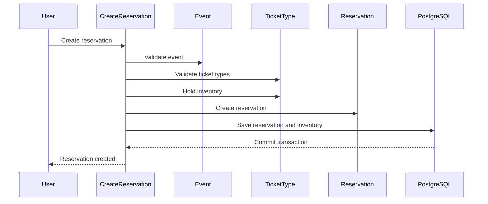
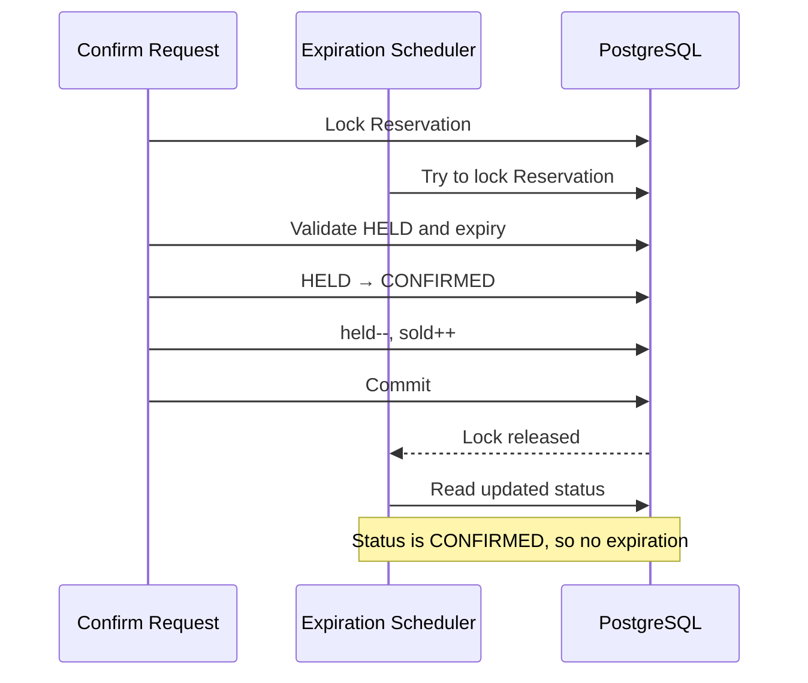
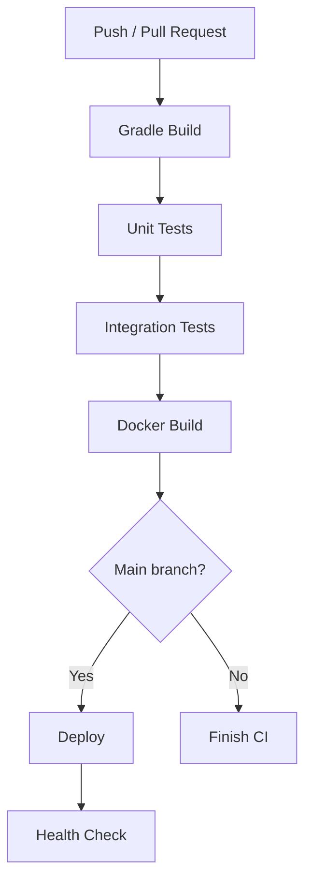
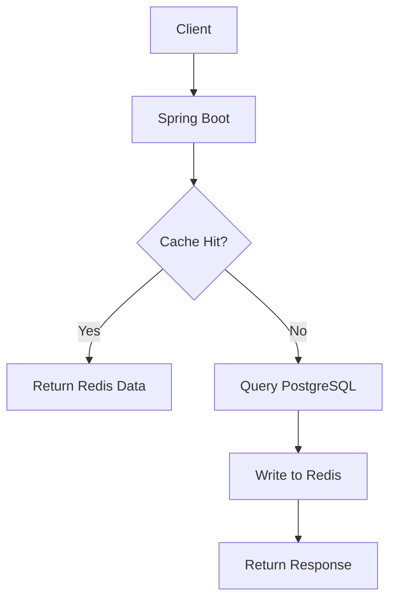
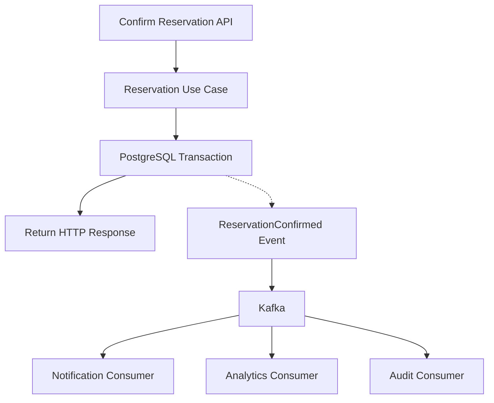
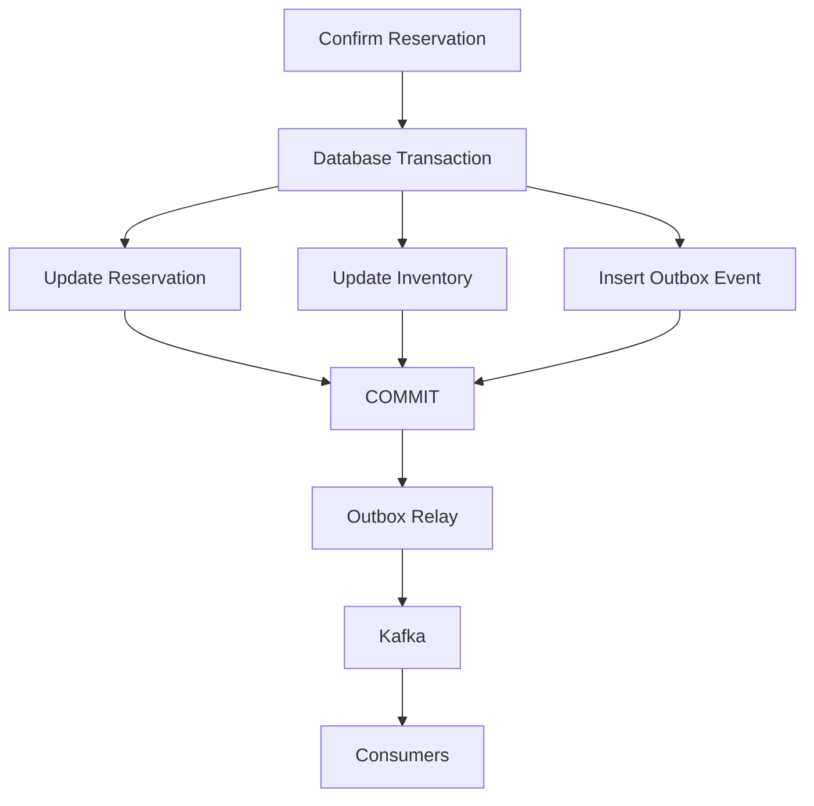
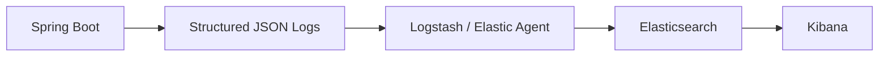
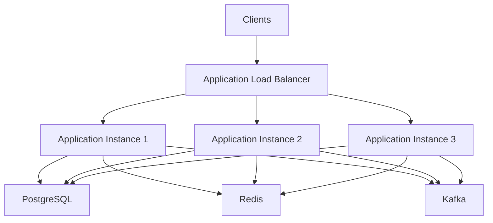
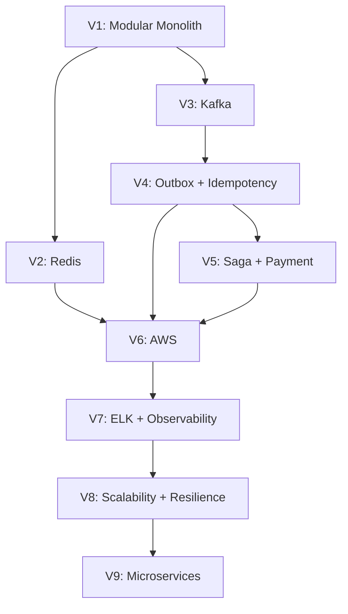

# RushSeat - Implement

**User:** Anonymous  
**Created:** 10/18/2026 10:31:29  
**Updated:** 11/8/2026 2:38:14  
**Exported:** 11/8/2026 2:43:21  
**Link:** [https://chatgpt.com/c/6ad43d90-4f38-83ec-9f76-60997142e023](https://chatgpt.com/c/6ad43d90-4f38-83ec-9f76-60997142e023)  

## Prompt:
11/8/2026, 1:57:35 AM

Cụ thể từng phase ra phải làm chi tiết cái gì

## Response:
11/8/2026, 1:57:39 AM · gpt-6

> **Đang gọi lại**
>
>
> ****
>
> 
>
> **Lập kế hoạch chi tiết**
>
> Mình đang xây dựng lộ trình chín giai đoạn, giữ React trong phạm vi MVP, đồng thời tách rõ mục tiêu, công việc, tiêu chí hoàn thành và những phần chưa cần làm.
>
> **Xác nhận hướng triển khai**
>
> Mình đang chốt lộ trình gồm JWT, React và chín giai đoạn: domain, persistence, application, API, security, frontend, concurrency, testing/performance và deployment, kèm tiêu chí hoàn thành cụ thể.
>
> **Xác định lộ trình và rà soát phạm vi MVP RushSeat**
>
> 
>
> Đã xử lý trong 11s

Với RushSeat, mình đề xuất chia roadmap thành **10 phase**, đi từ Domain Model hiện tại đến một MVP có thể sử dụng được end-to-end. Mỗi phase sẽ có danh sách công việc, kết quả cần tạo ra và điều kiện để chuyển sang phase tiếp theo.

Mình giữ nguyên định hướng đã thống nhất: **Java 21, Spring Boot, PostgreSQL, Flyway, Hexagonal Architecture, Modular Monolith**\. React + TypeScript là frontend của MVP. PostgreSQL vẫn là nguồn dữ liệu chính thức cho inventory.

# Tổng quan roadmap

# RushSeat - MVP Roadmap

Trạng thái tại ngày 08/11/2026

\* Domain Model đã được xây dựng; cần xác nhận toàn bộ unit tests chạy thành công trên project thực tế.

---

# Phase 1 - Domain Foundation

(Đã hoàn thành phần lớn)

**Mục tiêu\:** Xây dựng mô hình nghiệp vụ độc lập với framework và database.

### 1.1. Domain Models

Các model cần có\:

| Model | Trách nhiệm |
|--------|--------|
| `User` | Thông tin người dùng, role |
| `Event` | Vòng đời sự kiện |
| `TicketType` | Giá vé, số lượng vé |
| `Reservation` | Vòng đời đặt vé |
| `ReservationItem` | Chi tiết vé trong reservation |

### 1.2. Domain Invariants

Kiểm tra các quy tắc\:

- User phải có email hợp lệ, role hợp lệ.
- Event phải có `endsAt > startsAt`\.
- Event chỉ nhận reservation khi PUBLISHED và nằm trong khoảng thời gian cho phép.
- TicketType không được có inventory âm.
- `heldQuantity + soldQuantity <= totalQuantity`\.
- Reservation phải có ít nhất một ReservationItem.
- Một Reservation không được chứa trùng TicketType.
- Các TicketType trong cùng Reservation phải thuộc cùng Event.
- Reservation không được confirm khi đã hết hạn.

### 1.3. State Transitions

Event\:

```text
DRAFT ──> PUBLISHED ──> CANCELLED
   └──────────────────> CANCELLED
```

Reservation\:

```text
             ┌────────────> CONFIRMED
             │
HELD ────────┼────────────> CANCELLED
             │
             └────────────> EXPIRED
```

Confirmed Reservation có thể đi vào workflow hủy riêng\:

```text
CONFIRMED
    |
    v
CANCELLATION_PENDING
    |
    v
CANCELLED
```

### 1.4. Unit Tests

- Test constructor và factory methods.
- Test validation.
- Test state transitions.
- Test inventory invariants.
- Test timestamp boundaries.
- Test immutability.
- Test arithmetic overflow.

**Definition of Done\:** Tất cả Domain Models có unit tests chạy thành công, không phụ thuộc Spring hoặc JPA.

**Trạng thái hiện tại\:** Bạn đã xây dựng cả 5 model. Cần chạy lại bộ test tổng thể để xác nhận.

---

# Phase 2 - Persistence Layer

(Phase hiện tại)

**Mục tiêu\:** Lưu và khôi phục Domain Model từ PostgreSQL mà không làm rò rỉ persistence concerns vào Business Layer.

Đây là phase bạn nên tập trung tiếp theo.

## 2.1. Database Schema

(Hoàn thành)

Bạn đã có\:

- PostgreSQL local.
- Flyway V1 migration.
- 5 bảng nghiệp vụ.
- 1 bảng `flyway_schema_history`\.
- Foreign keys, constraints và indexes cơ bản.

Đã kiểm tra Flyway tạo thành công đủ 6 bảng.

## 2.2. JPA Entities

Tạo các entity trong `data.entity`\:

```text
data/
└── entity/
    ├── UserEntity.java
    ├── EventEntity.java
    ├── TicketTypeEntity.java
    ├── ReservationEntity.java
    └── ReservationItemEntity.java
```

Công việc cần làm\:

- Khai báo `@Entity`, `@Table`, `@Id`\.
- Mapping các cột với database.
- Mapping enum bằng `EnumType.STRING`\.
- Mapping `Instant` với PostgreSQL `TIMESTAMPTZ`\.
- Mapping `NUMERIC(15,0)` với kiểu dữ liệu phù hợp.
- Mapping relationships và foreign keys.
- Thiết lập collection cho `ReservationEntity` và `ReservationItemEntity`\.
- Xác định cascade và fetch strategy.

Một số điểm cần chú ý\:

- Không dùng JPA Entity thay cho Domain Model.
- Không để Entity tự chứa business logic.
- Cẩn thận với lazy loading và việc mapping collection.
- Không tùy tiện dùng `CascadeType.ALL` cho mọi quan hệ.

## 2.3. Spring Data Repositories

Tạo repository\:

```text
data/
└── repository/
    ├── UserJpaRepository.java
    ├── EventJpaRepository.java
    ├── TicketTypeJpaRepository.java
    └── ReservationJpaRepository.java
```

Các truy vấn cần thiết\:

| Repository | Query cần có |
|--------|--------|
| User | Find by email |
| Event | Find by ID, find published events |
| Event | Find events by organizer |
| TicketType | Find by event ID |
| TicketType | Find multiple ticket types by IDs |
| Reservation | Find by ID |
| Reservation | Find reservations by user |
| Reservation | Find expired HELD reservations |

Không cần tạo quá nhiều query từ đầu. Chỉ implement những query phục vụ Use Case thực tế.

## 2.4. Persistence Mappers

Mapper chuyển đổi\:

```text
Domain Model <──> JPA Entity
```

Ví dụ\:

```text
Reservation
     |
     v
ReservationMapper
     |
     v
ReservationEntity
```

Đặc biệt với Reservation\:

- Map Reservation sang ReservationEntity.
- Map từng ReservationItem.
- Khi khôi phục, phải đảm bảo `Reservation.items` được tạo đúng.
- Không làm mất `createdAt`, `updatedAt`, `expiresAt`, `status`\.
- Không tính lại `unitPrice` từ TicketType hiện tại vì đây là snapshot tại thời điểm đặt vé.

## 2.5. Persistence Adapters

Tạo các adapter implement Output Ports của Business Layer\:

```text
data/
└── adapter/
    ├── UserPersistenceAdapter.java
    ├── EventPersistenceAdapter.java
    ├── TicketTypePersistenceAdapter.java
    └── ReservationPersistenceAdapter.java
```

Các adapter chịu trách nhiệm\:

- Nhận Domain Model.
- Chuyển sang Entity.
- Gọi Spring Data Repository.
- Chuyển kết quả về Domain Model.
- Xử lý các trường hợp không tìm thấy dữ liệu theo contract của Port.

## 2.6. Integration Tests

Kiểm tra với PostgreSQL thực tế, ưu tiên Testcontainers\:

- Save và retrieve User.
- Save và retrieve Event.
- Save và retrieve TicketType.
- Save Reservation có nhiều ReservationItems.
- Retrieve Reservation và kiểm tra đầy đủ items.
- Kiểm tra enum, timestamp và monetary values.
- Kiểm tra rollback khi persistence operation thất bại.

**Definition of Done - Phase 2**

- [ ] Tất cả JPA Entities mapping đúng V1 schema.
- [ ] Repository hoạt động.
- [ ] Mapper không làm mất dữ liệu.
- [ ] Adapter implement đầy đủ Output Ports.
- [ ] Integration tests chạy thành công với PostgreSQL.
- [ ] `ddl-auto: validate` không báo lỗi.

---

# Phase 3 - Application Layer / Use Cases

**Mục tiêu\:** Kết nối Domain Model với Persistence Layer để tạo ra các nghiệp vụ thực tế.

Đây là phase quan trọng nhất về mặt business flow.

## 3.1. User Use Cases

| Use Case | Mô tả |
|--------|--------|
| `RegisterUser` | Đăng ký tài khoản |
| `GetUserProfile` | Xem thông tin cá nhân |

Đăng ký tài khoản mặc định có role `CUSTOMER`\.

## 3.2. Event Use Cases

| Use Case | Mô tả |
|--------|--------|
| `CreateEvent` | Organizer tạo Event |
| `UpdateEvent` | Chỉnh sửa Event DRAFT |
| `PublishEvent` | Publish Event |
| `CancelEvent` | Hủy Event |
| `GetEventDetails` | Xem chi tiết Event |
| `ListPublishedEvents` | Danh sách Event đang mở bán |

Lưu ý: Organizer chỉ được thao tác với Event thuộc quyền sở hữu của mình.

## 3.3. TicketType Use Cases

| Use Case | Mô tả |
|--------|--------|
| `CreateTicketType` | Tạo loại vé |
| `UpdateTicketType` | Cập nhật thông tin vé |
| `UpdateTicketPrice` | Cập nhật giá |
| `UpdateTicketQuantity` | Điều chỉnh tổng số lượng vé |
| `ListTicketTypes` | Xem loại vé của Event |

Đặc biệt cần kiểm tra\:

- Không giảm `totalQuantity` thấp hơn `heldQuantity + soldQuantity`\.
- Không cho phép thay đổi TicketType thuộc Event không được quản lý.
- Giá vé trong Reservation phải được snapshot.

## 3.4. Reservation Use Cases

Đây là phần trọng tâm của RushSeat.

| Use Case | Mô tả |
|--------|--------|
| `CreateReservation` | Tạo Reservation |
| `GetReservationDetails` | Xem chi tiết Reservation |
| `ListMyReservations` | Xem lịch sử đặt vé |
| `ConfirmReservation` | Xác nhận Reservation |
| `CancelReservation` | Hủy Reservation HELD |
| `ExpireReservation` | Hết hạn Reservation |

### Luồng CreateReservation



Các bước cần xử lý\:

1. Kiểm tra User tồn tại.
2. Kiểm tra Event tồn tại và đang mở bán.
3. Kiểm tra tất cả TicketType thuộc Event đó.
4. Kiểm tra quantity hợp lệ.
5. Tính `unitPrice` snapshot.
6. Hold inventory.
7. Tạo Reservation với trạng thái HELD.
8. Thiết lập `expiresAt = now + 5 minutes`\.
9. Lưu Reservation và inventory trong cùng transaction.
10. Trả kết quả cho caller.

**Điểm quan trọng\:** Transaction phải đảm bảo không xảy ra trường hợp inventory đã được hold nhưng Reservation không được lưu, hoặc ngược lại.

## 3.5. ConfirmReservation

1. Load Reservation.
2. Kiểm tra quyền sở hữu.
3. Kiểm tra Reservation còn HELD.
4. Kiểm tra chưa hết hạn.
5. Chuyển Reservation sang CONFIRMED.
6. Với mỗi ReservationItem, gọi `TicketType.sell(quantity)`\.
7. Lưu tất cả trong cùng transaction.

## 3.6. CancelReservation

1. Load Reservation.
2. Kiểm tra quyền sở hữu.
3. Chỉ cho phép hủy khi HELD và chưa hết hạn.
4. Chuyển Reservation sang CANCELLED.
5. Release held inventory.
6. Commit transaction.

Không đưa logic hủy confirmed reservation vào cùng Use Case này. Đó là workflow riêng.

## 3.7. Unit Tests cho Application Layer

Dùng Mockito để kiểm tra\:

- Event không tồn tại.
- Event chưa publish.
- Event đã kết thúc.
- TicketType không thuộc Event.
- Inventory không đủ.
- Reservation hết hạn.
- User không có quyền truy cập.
- Repository ném exception.
- Các thao tác phối hợp đúng thứ tự.

**Definition of Done - Phase 3**

Có thể chạy các Use Case trực tiếp mà không cần HTTP Controller.

Đặc biệt, tạo Reservation, confirm, cancel và expire phải bảo toàn inventory invariants.

---

# Phase 4 - REST API

**Mục tiêu\:** Expose Application Use Cases thông qua REST API.

## 4.1. API Endpoints

Một bộ endpoint phù hợp với MVP\:

| Method | Endpoint | Chức năng |
|--------|--------|--------|
| POST | `/api/v1/auth/register` | Đăng ký |
| POST | `/api/v1/auth/login` | Đăng nhập |
| GET | `/api/v1/events` | Danh sách Event |
| GET | `/api/v1/events/{id}` | Chi tiết Event |
| POST | `/api/v1/events` | Tạo Event |
| PATCH | `/api/v1/events/{id}` | Sửa Event |
| POST | `/api/v1/events/{id}/publish` | Publish |
| POST | `/api/v1/events/{id}/cancel` | Hủy Event |
| GET | `/api/v1/events/{id}/ticket-types` | Danh sách loại vé |
| POST | `/api/v1/events/{id}/ticket-types` | Tạo loại vé |
| POST | `/api/v1/reservations` | Đặt vé |
| GET | `/api/v1/reservations/{id}` | Chi tiết đặt vé |
| GET | `/api/v1/me/reservations` | Lịch sử đặt vé |
| POST | `/api/v1/reservations/{id}/confirm` | Xác nhận |
| POST | `/api/v1/reservations/{id}/cancel` | Hủy |

## 4.2. Request / Response DTOs

Tạo DTO riêng cho từng endpoint.

Ví dụ\:

```json
{
  "eventId": 1,
  "items": [
    {
      "ticketTypeId": 10,
      "quantity": 2
    },
    {
      "ticketTypeId": 11,
      "quantity": 1
    }
  ]
}
```

Response có thể chứa\:

- Reservation ID.
- Event ID.
- Reservation status.
- Items.
- Unit price snapshot.
- Total amount.
- Created time.
- Expiration time.

## 4.3. API Infrastructure

- Bean Validation.
- Global Exception Handler.
- Chuẩn hóa HTTP status codes.
- Pagination cho danh sách Event.
- OpenAPI / Swagger.
- Không trả JPA Entity trực tiếp.

**Definition of Done\:** Có thể thực hiện các nghiệp vụ chính qua HTTP client như Postman mà chưa cần frontend.

---

# Phase 5 - Authentication &amp; Authorization

**Mục tiêu\:** Bảo vệ API và phân quyền đúng theo nghiệp vụ.

## 5.1. Authentication

Implement\:

- Spring Security configuration.
- Password hashing với BCrypt.
- Login authentication.
- JWT generation.
- JWT validation.
- JWT authentication filter.
- Security context.

## 5.2. Authorization

Các role\:

| Role | Quyền |
|--------|--------|
| CUSTOMER | Xem Event, đặt vé, quản lý Reservation của mình |
| ORGANIZER | Quản lý Event và TicketType thuộc quyền sở hữu |
| ADMIN | Quyền quản trị hệ thống theo phạm vi MVP |

Cần kiểm tra cả hai lớp\:

- Role-based authorization.
- Resource ownership.

Ví dụ, có role ORGANIZER không đồng nghĩa với việc được chỉnh sửa Event của Organizer khác.

## 5.3. Security Tests

- Không có token → 401.
- Token không hợp lệ → 401.
- CUSTOMER gọi endpoint dành cho ORGANIZER → 403.
- ORGANIZER truy cập Event của người khác → 403 hoặc 404 theo API policy đã chọn.
- CUSTOMER truy cập Reservation của người khác → không được phép.
- Password không được lưu dạng plaintext.

**Definition of Done\:** Các API nghiệp vụ được bảo vệ và authorization tests chạy thành công.

---

# Phase 6 - Frontend

**Mục tiêu\:** Xây dựng một giao diện đủ để người dùng thực hiện toàn bộ luồng nghiệp vụ chính.

Stack\:

- React.
- TypeScript.
- React Router.
- Axios hoặc Fetch API.
- Một thư viện quản lý server state nếu cần, ví dụ TanStack Query.

Không cần xây dựng frontend quá phức tạp.

## 6.1. Customer UI

[](https://www.judypodraza.com/msg-digital-transformation)

**Event Listing**

- Danh sách Event đang mở bán.
- Xem tên, thời gian, mô tả.
- Chọn Event để xem chi tiết.

---

[](https://www.prioticket.com/e-commerce)

**Event Details**

- Xem TicketType.
- Xem giá vé và số lượng khả dụng.
- Chọn số lượng vé.
- Tạo Reservation.

---

[](https://dribbble.com/shots/22009381-Concert-Ticket)

**Reservation Checkout**

- Hiển thị thông tin Reservation.
- Countdown 5 phút.
- Confirm Reservation.
- Cancel Reservation.

---

[](https://dribbble.com/shots/20068110-Audience-Services-Website-Design)

**My Reservations**

- Xem lịch sử.
- Xem trạng thái HELD, CONFIRMED, CANCELLED, EXPIRED.
- Xem chi tiết Reservation.

## 6.2. Organizer UI

- Dashboard Event của Organizer.
- Create Event.
- Update Event DRAFT.
- Publish / Cancel Event.
- Quản lý TicketType.
- Xem số lượng tổng, held, sold, available.

## 6.3. Authentication UI

- Register.
- Login.
- Logout.
- Route protection.
- Xử lý token hết hạn.

**Definition of Done\:** Customer có thể đặt và xác nhận vé bằng UI; Organizer có thể tạo và quản lý Event.

---

# Phase 7 - Concurrency &amp; Reliability

(Phase đặc biệt quan trọng với RushSeat)

**Mục tiêu\:** Đảm bảo inventory chính xác khi nhiều request cùng thao tác trên một TicketType.

Đây là phần tạo nên giá trị kỹ thuật chính của RushSeat.

## 7.1. Inventory Concurrency

Vấn đề\:

Giả sử TicketType chỉ còn 1 vé. Hai request đến cùng lúc và cùng đọc `availableQuantity = 1`\.

Nếu cả hai đều thực hiện hold, hệ thống có thể oversell.

Bạn cần implement cơ chế kiểm soát đồng thời ở database.

Các việc cần làm\:

- Chọn cơ chế locking phù hợp.
- Implement transaction cho thao tác hold.
- Đảm bảo nhiều TicketType được xử lý trong cùng transaction.
- Kiểm soát thứ tự lock để hạn chế deadlock.
- Kiểm tra database constraints như lớp bảo vệ cuối cùng.

Một hướng triển khai phù hợp để bắt đầu là PostgreSQL pessimistic locking với `SELECT ... FOR UPDATE` thông qua JPA.

Không dùng Redis làm nguồn quyết định inventory.

## 7.2. Confirm vs Expire Race Condition

Hai luồng có thể chạy cùng lúc\:



Bạn cần đảm bảo\:

- Reservation chỉ được chuyển trạng thái một lần.
- Inventory chỉ được thay đổi tương ứng với transition hợp lệ.
- Confirm và expire không thể cùng giải phóng hoặc bán một lượng vé hai lần.
- Tất cả thay đổi phải nằm trong transaction.

## 7.3. Reservation Expiration Scheduler

Implement\:

- `@EnableScheduling`\.
- Scheduled task.
- Query các Reservation HELD đã hết hạn.
- Gọi Application Use Case `ExpireReservation`\.
- Release inventory.
- Xử lý batch thay vì tải toàn bộ dữ liệu cùng lúc.

Scheduler chỉ đóng vai trò trigger. Business logic vẫn nằm trong Application Layer.

## 7.4. Event Cancellation

Khi Event bị hủy\:

- Ngăn Reservation mới.
- Xử lý các Reservation HELD còn hiệu lực.
- Xử lý inventory đang được hold.
- Xác định workflow cho CONFIRMED Reservation.

Với MVP chưa tích hợp payment, cần quy định rõ confirmed reservation sẽ chuyển sang trạng thái hủy theo workflow nghiệp vụ đã thiết kế.

## 7.5. Quantity Update

Không được giảm `totalQuantity` xuống thấp hơn\:

$$
heldQuantity + soldQuantity
$$

**Definition of Done\:**

- Không oversell khi nhiều request cùng hold.
- Confirm và expire không gây double release.
- Inventory không bị âm.
- Event cancellation không để Reservation tiếp tục được tạo.
- Các transaction giữ được tính nhất quán.

---

# Phase 8 - Testing &amp; Performance

**Mục tiêu\:** Chứng minh hệ thống hoạt động đúng, không chỉ chạy được.

## 8.1. Testing Strategy

| Test type | Công cụ | Phạm vi |
|--------|--------|--------|
| Unit Test | JUnit 5 | Domain Model |
| Unit Test | Mockito | Application Use Cases |
| Integration Test | Testcontainers | PostgreSQL, persistence |
| API Test | MockMvc | HTTP endpoints |
| Security Test | Spring Security Test | Authentication, authorization |
| Concurrency Test | JUnit + threads | Inventory race conditions |
| Load Test | k6 | Throughput, latency |

## 8.2. Các kịch bản bắt buộc

**Reservation lifecycle**

- Tạo Reservation thành công.
- Inventory không đủ.
- Confirm thành công.
- Confirm sau expiration.
- Cancel Reservation HELD.
- Scheduler expire Reservation.
- Confirm và expire xảy ra đồng thời.

**Inventory concurrency**

- Nhiều request mua cùng một TicketType.
- Số lượng vé còn ít hơn số lượng request.
- Nhiều TicketType trong một Reservation.
- Rollback khi một TicketType trong Reservation không đủ inventory.
- Nhiều request đồng thời cập nhật cùng TicketType.

**API &amp; Security**

- Không có JWT.
- JWT sai.
- Sai role.
- Sai resource ownership.
- Request thiếu dữ liệu.
- Resource không tồn tại.

## 8.3. Load Testing với k6

Xây dựng các kịch bản\:

1. Normal traffic.
2. Traffic tăng đột ngột khi mở bán.
3. Nhiều request cùng mua một TicketType.
4. Nhiều request mua các TicketType khác nhau.
5. Reservation creation và confirmation đồng thời.

Đo\:

- Throughput.
- P50/P95/P99 latency.
- Error rate.
- Database connection utilization.
- Inventory correctness.
- Lock wait time.

Không đặt số liệu hiệu năng vào CV trước khi thực sự đo được.

**Definition of Done\:** Test chứng minh được hệ thống không oversell trong những kịch bản đồng thời đã thiết kế.

---

# Phase 9 - Deployment &amp; CI/CD

**Mục tiêu\:** Đưa RushSeat ra khỏi môi trường local development.

## 9.1. Docker

Tạo\:

```text
rushseat/
├── Dockerfile
├── compose.yaml
├── .dockerignore
└── ...
```

Docker Compose ban đầu gồm\:

- Spring Boot application.
- PostgreSQL.

Chưa cần Redis hoặc Kafka trong MVP.

## 9.2. Configuration

Tách cấu hình theo môi trường\:

```text
application.yaml
application-local.yaml
application-test.yaml
application-prod.yaml
```

Các thông tin nhạy cảm\:

- Database credentials.
- JWT secret.
- Application secrets.

Phải lấy từ environment variables hoặc secret management, không commit vào Git.

## 9.3. CI/CD

GitHub Actions\:

```text
Push / Pull Request
        |
        v
    Gradle Build
        |
        v
      Unit Tests
        |
        v
 Integration Tests
        |
        v
 Docker Build
        |
        v
      Deploy
```

Các bước nên có\:

- Gradle build.
- Unit tests.
- Integration tests.
- Docker image build.
- Deploy khi merge vào branch release/main theo workflow đã chọn.

## 9.4. Deployment

Giai đoạn đầu\:

- Docker Compose trên môi trường deploy.
- PostgreSQL database.
- HTTPS.
- Domain.
- Health checks.

AWS EC2/RDS có thể là lựa chọn triển khai khi MVP local đã ổn định. Không cần Kubernetes.

**Definition of Done\:** Có một môi trường deploy mà người khác có thể truy cập và sử dụng RushSeat.

---

# Phase 10 - MVP Validation &amp; Documentation

**Mục tiêu\:** Kiểm tra sản phẩm từ góc độ người dùng và hoàn thiện tài liệu kỹ thuật.

## 10.1. End-to-End Validation

Chạy thử toàn bộ flow\:

## RushSeat - End-to-End Flow

1. Customer đăng ký và đăng nhập.
2. Organizer tạo Event.
3. Organizer tạo TicketTypes.
4. Organizer publish Event.
5. Customer chọn vé và tạo Reservation.
6. Inventory chuyển từ available sang held.
7. Customer confirm Reservation trong 5 phút.
8. Inventory chuyển từ held sang sold.
9. Customer xem Reservation đã xác nhận.

---

**Kiểm tra thêm\:** Tạo Reservation khác rồi để hết hạn. Scheduler phải chuyển trạng thái sang EXPIRED và release inventory.

## 10.2. Documentation

Các tài liệu nên có\:

- README.
- Problem Statement.
- Business Requirements.
- Domain Model.
- Architecture Diagram.
- ERD.
- Sequence Diagrams.
- API Documentation.
- Database Schema.
- Testing Strategy.
- Performance Test Results.
- Deployment Guide.

## 10.3. Project Demonstration

Chuẩn bị demo các tình huống\:

1. Tạo và publish Event.
2. Đặt vé thành công.
3. Reservation hết hạn.
4. Inventory không đủ.
5. Nhiều request cùng đặt vé.
6. Xác minh không xảy ra oversell.

---

# Những công nghệ chưa cần đưa vào MVP

Với phạm vi hiện tại, mình khuyên không đưa những thành phần sau vào implementation chính\:

| Công nghệ / Feature | Quyết định |
|--------|--------|
| Redis | Để Phase tối ưu hóa sau MVP |
| Kafka | Để Phase mở rộng sau MVP |
| Payment Gateway | Không có trong MVP |
| Microservices | Không sử dụng |
| Kubernetes | Không cần |
| Distributed Lock | Không cần khi chưa phân tán hệ thống |
| Idempotency Key | Chưa đưa vào các bước đầu; cân nhắc khi có integration/retry requirements |
| Caching Layer | Chưa cần trước khi có baseline performance |

Điều này không có nghĩa là chúng không hữu ích. Chỉ là chưa cần thiết để chứng minh bài toán cốt lõi của RushSeat.

---

# Thứ tự triển khai thực tế từ hôm nay

Đây là thứ tự mình muốn bạn follow, tránh nhảy sang frontend hoặc Redis quá sớm.

## Implementation Checklist

**Overall progress**

# /

Checklist để theo dõi các đầu việc triển khai. Các mục chưa được đánh dấu không có nghĩa là bạn chưa từng làm chúng.

[Reset checklist]

*Checklist trên là bảng theo dõi tương tác trong phiên này, không tự đồng bộ vào repository.*

## Việc bạn nên làm ngay tiếp theo

Hiện tại, không cần quay lại thiết kế Domain Model hay sửa lại V1 schema nếu chưa có lỗi mới.

Mình đề xuất triển khai Phase 2 theo từng batch\:

1. **Batch 1\:** `UserEntity`, `UserJpaRepository`, `UserMapper`, `UserPersistenceAdapter`\.
2. **Batch 2\:** `EventEntity`, `EventJpaRepository`, `EventMapper`, `EventPersistenceAdapter`\.
3. **Batch 3\:** `TicketTypeEntity`, repository, mapper và adapter.
4. **Batch 4\:** `ReservationEntity`, `ReservationItemEntity`, repository, mapper và adapter.
5. **Batch 5\:** Integration tests và kiểm tra transaction/persistence.

Làm xong từng batch mới chuyển sang batch tiếp theo. Không cần tạo toàn bộ entity và adapter cùng lúc rồi mới kiểm tra.

**Một nguyên tắc xuyên suốt\:** RushSeat chỉ được xem là hoàn thành MVP khi một Customer có thể thực sự đặt vé, inventory được giữ đúng, confirm hoặc expire đúng trạng thái, và hệ thống vẫn không oversell dưới tải đồng thời. Có đủ controller, database và frontend nhưng chưa chứng minh được điều này thì chưa phải MVP hoàn chỉnh.

## Prompt:
11/8/2026, 2:03:59 AM

Nếu chuyển sang qua phase hoàn thiện dự án 1 cách trọn vẹn thì như nào đi vào chi tiết

## Response:
11/8/2026, 2:04:02 AM · gpt-6

Nếu mục tiêu là **hoàn thiện RushSeat thành một dự án Backend/Full-stack thực sự hoàn chỉnh, có thể đưa lên GitHub, deploy, demo, kiểm thử và sử dụng làm project chính trong CV**, thì mình nghĩ nên thay đổi cách nhìn một chút.

Không nên chỉ xem RushSeat là một danh sách công nghệ cần implement. Hãy xem nó như một sản phẩm phần mềm có đầy đủ vòng đời\:

1. Xác định vấn đề cần giải quyết.
2. Phân tích nghiệp vụ và yêu cầu.
3. Thiết kế hệ thống.
4. Implement.
5. Kiểm thử và tối ưu.
6. Deploy.
7. Vận hành, quan sát và cải tiến.
8. Hoàn thiện tài liệu và chuẩn bị trình bày dự án.

Mình sẽ xây dựng roadmap theo hướng đó, giữ nguyên định hướng Modular Monolith + Hexagonal Architecture của RushSeat.

# I. Tổng thể vòng đời hoàn thiện RushSeat

# RushSeat - Complete Project Lifecycle

Từ ý tưởng đến sản phẩm có thể demo và đánh giá kỹ thuật

1. **Product Discovery &amp; Problem Definition**
   
   Xác định vấn đề, người dùng và giá trị sản phẩm.
2. **Requirements Engineering**
   
   Xây dựng yêu cầu chức năng, phi chức năng và business rules.
3. **System Design &amp; Architecture**
   
   Thiết kế kiến trúc, domain, database, API và các luồng xử lý.
4. **Development Environment &amp; Engineering Foundation**
   
   Chuẩn hóa project, build, configuration, Git và CI.
5. **Backend Core Implementation**
   
   Domain, Persistence, Application và REST API.
6. **Security &amp; Access Control**
   
   Authentication, authorization và bảo vệ dữ liệu.
7. **Frontend Implementation**
   
   Giao diện Customer và Organizer.
8. **Concurrency &amp; Reliability Engineering**
   
   Chống oversell, xử lý expiration và transaction consistency.
9. **Testing &amp; Performance Engineering**
   
   Unit, integration, concurrency, load và end-to-end testing.
10. **Deployment &amp; CI/CD**
    
    Docker, môi trường production và tự động hóa triển khai.
11. **Observability &amp; Operational Readiness**
    
    Logging, metrics, health checks và xử lý sự cố.
12. **Product Validation &amp; Project Delivery**
    
    Demo, tài liệu, đánh giá kết quả và hoàn thiện CV.

Trong roadmap này, một số phase bạn đã làm trước đó sẽ được tái sử dụng. Không cần làm lại từ đầu.

---

# II. Chi tiết từng phase

## Phase 1 - Product Discovery &amp; Problem Definition

**Mục tiêu\:** Xác định chính xác RushSeat giải quyết vấn đề gì và tại sao cần xây dựng hệ thống này.

Đây là bước nhiều developer bỏ qua. Họ thường bắt đầu bằng cách tạo Spring Boot project rồi implement CRUD mà chưa xác định được bài toán.

### 1.1. Define the Problem

Vấn đề chính của RushSeat\:

Khi một sự kiện mở bán vé, nhiều người dùng có thể đồng thời gửi yêu cầu đặt cùng một loại vé. Nếu hệ thống không kiểm soát concurrency đúng cách, có thể xảy ra\:

- Overselling: bán nhiều vé hơn số lượng thực tế.
- Double reservation: một lượng inventory bị giữ nhiều lần.
- Inconsistent state: Reservation đã được xác nhận nhưng inventory không được cập nhật.
- Stale reservation: vé vẫn bị giữ dù Reservation đã hết hạn.
- Race condition: hai request cùng thay đổi trạng thái một Reservation.

Bạn cần viết rõ\:

- Hiện trạng hoặc vấn đề giả định.
- Nguyên nhân kỹ thuật.
- Hậu quả đối với người dùng.
- Hệ thống cần giải quyết điều gì.

### 1.2. Define Stakeholders

| Actor | Nhu cầu |
|--------|--------|
| Customer | Tìm sự kiện, đặt vé, xác nhận vé |
| Organizer | Tạo và quản lý sự kiện |
| Admin | Quản trị hệ thống |
| System | Đảm bảo inventory và reservation consistency |

### 1.3. Define Product Scope

Chia phạm vi thành ba nhóm\:

| Nhóm | Chức năng |
|--------|--------|
| Core MVP | Event, TicketType, Reservation, inventory |
| Supporting MVP | Authentication, authorization, frontend, deployment |
| Future Enhancement | Payment, Redis, Kafka, notifications |

### 1.4. Define Success Criteria

Không chỉ đặt mục tiêu "API hoạt động".

Ví dụ\:

- Customer có thể tạo Reservation.
- Reservation có thời hạn giữ vé 5 phút.
- Reservation hết hạn được release inventory.
- Confirm và expire không thể xảy ra đồng thời theo cách gây double update.
- Hệ thống không oversell trong concurrency tests.
- API có authentication và authorization.
- Hệ thống được deploy và truy cập từ môi trường bên ngoài.

**Deliverables\:**

```text
docs/
└── product/
    ├── problem-statement.md
    ├── product-scope.md
    ├── stakeholders.md
    └── success-criteria.md
```

**Definition of Done\:** Bạn có thể giải thích bài toán, người dùng, phạm vi và tiêu chí thành công của RushSeat trong khoảng 3-5 phút.

---

## Phase 2 - Requirements Engineering

**Mục tiêu\:** Chuyển Problem Statement thành những yêu cầu có thể implement và kiểm thử.

### 2.1. Functional Requirements

Xây dựng requirement theo từng module.

| Module | Functional Requirements |
|--------|--------|
| User | Register, Login, View Profile |
| Event | Create, Update, Publish, Cancel, View |
| TicketType | Create, Update, View |
| Reservation | Create, Confirm, Cancel, Expire |
| Inventory | Hold, Release, Sell, Adjust Quantity |
| Authorization | Kiểm soát quyền truy cập |

Mỗi requirement nên có ID.

Ví dụ\:

```text
FR-RES-001: Customer can create a reservation.

FR-RES-002: A reservation must contain at least one
ticket type.

FR-RES-003: A reservation must expire after 5 minutes
if it has not been confirmed.

FR-RES-004: An expired reservation cannot be confirmed.
```

### 2.2. Non-Functional Requirements

Đây là phần quan trọng với một project Backend.

| Category | Requirement |
|--------|--------|
| Performance | API response time cần được đo và đánh giá |
| Scalability | Xử lý nhiều request đồng thời |
| Consistency | Inventory không được oversell |
| Security | Authentication và authorization |
| Reliability | Transaction rollback khi thao tác thất bại |
| Maintainability | Tách biệt Domain, Application, Infrastructure |
| Observability | Có log và metrics để phân tích sự cố |

Không cần đặt ra những con số hiệu năng tùy ý. Bạn có thể đặt target sau khi có baseline và workload rõ ràng.

### 2.3. Business Rules

Đây là phần bạn đã xây dựng khá nhiều.

Ví dụ\:

```text
BR-001: Only PUBLISHED events can accept reservations.

BR-002: A reservation is valid for 5 minutes.

BR-003: A reservation can only be confirmed before expiration.

BR-004: Available inventory is calculated as:

available = total - held - sold

BR-005: A reservation cannot contain ticket types
belonging to different events.

BR-006: Confirming a reservation must atomically
move inventory from held to sold.
```

### 2.4. Acceptance Criteria

Mỗi Use Case cần có điều kiện nghiệm thu.

Ví dụ `CreateReservation`\:

- Given Event đang PUBLISHED.
- And Event đang trong thời gian mở bán.
- And TicketType còn đủ inventory.
- When Customer tạo Reservation.
- Then Reservation được tạo với trạng thái HELD.
- And inventory được hold.
- And `expiresAt` được thiết lập sau 5 phút.

Ngoài happy path, phải có negative cases.

**Deliverables\:**

```text
docs/
└── requirements/
    ├── functional-requirements.md
    ├── non-functional-requirements.md
    ├── business-rules.md
    └── acceptance-criteria.md
```

**Definition of Done\:** Mỗi chức năng MVP đều có requirement và acceptance criteria tương ứng.

---

## Phase 3 - System Design &amp; Architecture

**Mục tiêu\:** Thiết kế cách hệ thống được tổ chức trước khi implement.

Bạn đã có định hướng kiến trúc. Giai đoạn này cần biến định hướng thành tài liệu và quyết định kỹ thuật cụ thể.

### 3.1. High-Level Architecture

Kiến trúc\:

- Modular Monolith.
- Hexagonal Architecture.
- PostgreSQL làm source of truth.
- Redis và Kafka không thuộc MVP ban đầu.

Cấu trúc tổng thể\:

```text
RushSeat
│
├── API
│   ├── Controllers
│   ├── DTOs
│   └── Exception Handlers
│
├── Business
│   ├── Domain
│   ├── Application
│   └── Ports
│
├── Data
│   ├── Entities
│   ├── Repositories
│   ├── Mappers
│   └── Adapters
│
├── Infrastructure
│   ├── Scheduler
│   ├── Configuration
│   └── Observability
│
└── Security
    ├── JWT
    └── Authorization
```

### 3.2. Domain Design

Cần hoàn thiện\:

- Domain Model.
- Entity relationships.
- Aggregate boundaries.
- Domain invariants.
- State transitions.
- Business policies.

Một điểm quan trọng: `Reservation` là Aggregate Root quản lý `ReservationItem`\. Các thay đổi về trạng thái Reservation và inventory phải được điều phối qua Application Layer.

### 3.3. Database Design

Bạn đã có V1 schema.

Cần bổ sung tài liệu\:

- ERD.
- Data dictionary.
- Primary key và foreign key.
- Unique constraints.
- Check constraints.
- Index strategy.
- Transaction boundaries.

### 3.4. API Design

Thiết kế\:

- Endpoint.
- HTTP methods.
- Request/Response schema.
- Error response.
- Authentication requirements.
- Pagination.
- API versioning.

### 3.5. Sequence Diagrams

Ít nhất nên có\:

1. Register/Login.
2. Create Event.
3. Publish Event.
4. Create Reservation.
5. Confirm Reservation.
6. Cancel Reservation.
7. Expire Reservation.
8. Confirm vs Expire concurrency.

### 3.6. Architecture Decision Records

Bạn nên có ADR cho những quyết định quan trọng\:

| ADR | Decision |
|--------|--------|
| ADR-001 | Modular Monolith |
| ADR-002 | Hexagonal Architecture |
| ADR-003 | PostgreSQL as source of truth |
| ADR-004 | Reservation hold duration = 5 minutes |
| ADR-005 | Inventory concurrency control |
| ADR-006 | Reservation expiration strategy |
| ADR-007 | Direct confirmation without payment integration in MVP |

Mỗi ADR cần có Context, Decision, Alternatives và Consequences.

**Deliverables\:**

```text
docs/
└── architecture/
    ├── system-architecture.md
    ├── domain-model.md
    ├── database-design.md
    ├── api-design.md
    ├── sequence-diagrams/
    └── adr/
```

**Definition of Done\:** Người khác có thể đọc tài liệu và hiểu hệ thống được tổ chức thế nào, các quyết định quan trọng tại sao được đưa ra.

---

## Phase 4 - Development Foundation &amp; Engineering Standards

**Mục tiêu\:** Chuẩn hóa môi trường và quy trình phát triển trước khi mở rộng implementation.

Bạn đã có project skeleton và Flyway. Phần còn lại\:

### 4.1. Build &amp; Configuration

- Java 21.
- Gradle Kotlin DSL.
- Spring Boot.
- PostgreSQL.
- Flyway.
- Hibernate `ddl-auto: validate`\.
- Application profiles.
- Environment variables.

### 4.2. Code Quality

- Naming conventions.
- Package conventions.
- Exception conventions.
- Logging conventions.
- Dependency direction.
- Formatting.
- Static analysis nếu cần.

### 4.3. Git Workflow

Đề xuất\:

```text
main
  |
  └── develop
        |
        ├── feature/persistence-layer
        ├── feature/reservation-use-cases
        ├── feature/jwt-authentication
        └── feature/concurrency-control
```

Không bắt buộc phải dùng Git Flow đầy đủ. Với một developer, feature branch + pull request hoặc review checklist là đủ.

### 4.4. CI Foundation

Ngay từ đầu có thể thiết lập GitHub Actions\:

- Checkout.
- Setup JDK.
- Gradle build.
- Run unit tests.

Chưa cần deploy tự động ngay.

**Deliverables\:** Build reproducible, cấu hình rõ ràng, CI chạy được trên mỗi pull request.

---

## Phase 5 - Backend Core Implementation

(Đây là phần bạn đang chuẩn bị thực hiện)

**Mục tiêu\:** Xây dựng backend hoàn chỉnh theo Hexagonal Architecture.

Mình chia thành 4 lớp công việc.

### 5.1. Domain Layer

Bạn đã có\:

- User.
- Event.
- TicketType.
- Reservation.
- ReservationItem.

Cần xác nhận\:

- Toàn bộ unit tests pass.
- State transitions chính xác.
- Không có dependency tới framework.
- Invariants được bảo vệ.

### 5.2. Persistence Layer

Đây là phần hiện tại.

Thứ tự\:

1. User Entity + Repository + Mapper + Adapter.
2. Event Entity + Repository + Mapper + Adapter.
3. TicketType Entity + Repository + Mapper + Adapter.
4. Reservation và ReservationItem Entity + Repository + Mapper + Adapter.
5. Integration tests.

Đặc biệt\:

- Mapping `Instant` với `TIMESTAMPTZ`\.
- Mapping `NUMERIC(15,0)`\.
- Enum string mapping.
- Reservation items collection.
- Snapshot `unitPrice`\.
- Transaction rollback.
- Domain reconstitution.

### 5.3. Application Layer

Tổ chức Use Cases theo module.

```text
business/
└── application/
    ├── user/
    ├── event/
    ├── tickettype/
    └── reservation/
```

Các Use Cases chính\:

| Nhóm | Use Cases |
|--------|--------|
| User | RegisterUser, GetUserProfile |
| Event | CreateEvent, UpdateEvent, PublishEvent, CancelEvent |
| TicketType | CreateTicketType, UpdateTicketType |
| Reservation | CreateReservation, ConfirmReservation, CancelReservation, ExpireReservation |
| Query | GetEventDetails, ListPublishedEvents, GetReservationDetails |

Trong Application Layer, cần phân biệt\:

- Command: làm thay đổi state.
- Query: đọc dữ liệu.

Không nhất thiết phải áp dụng CQRS framework. Chỉ cần phân tách rõ trách nhiệm.

### 5.4. API Layer

- Controllers.
- Request DTOs.
- Response DTOs.
- Validation.
- Exception mapping.
- Pagination.
- OpenAPI.

**Definition of Done\:** Có thể chạy tất cả Use Cases qua REST API, dữ liệu được lưu và truy vấn đúng từ PostgreSQL.

---

## Phase 6 - Security Engineering

**Mục tiêu\:** Đảm bảo người dùng chỉ được thực hiện những hành động mà họ được phép.

### 6.1. Authentication

Implement\:

- BCrypt password hashing.
- Login.
- JWT access token.
- Token validation.
- Authentication filter.
- Security context.

### 6.2. Authorization

Phân quyền\:

| Actor | Allowed operations |
|--------|--------|
| CUSTOMER | View Event, Create Reservation, Manage own Reservation |
| ORGANIZER | Manage own Event and TicketTypes |
| ADMIN | Administrative operations |

Phải kiểm tra resource ownership ở Application Layer hoặc policy tương ứng, không chỉ dựa vào URL hay role.

### 6.3. Security Hardening

- Không log password hoặc JWT.
- Validate input.
- Không expose stack trace.
- CORS policy.
- Rate limiting nếu cần.
- Quản lý secrets qua environment.
- Không để user tự thay đổi role bằng API đăng ký.

**Definition of Done\:** Authentication và authorization được kiểm thử, các API nhạy cảm không thể bị truy cập trái phép.

---

## Phase 7 - Frontend &amp; User Experience

**Mục tiêu\:** Biến backend thành một sản phẩm có thể sử dụng.

Mình khuyên sử dụng React + TypeScript, nhưng không cần xây frontend quá lớn.

### 7.1. Customer Flow
[](https://dribbble.com/shots/25515578-Event-Ticket-Booking-Web-App)

[](https://www.kxticketsltd.com/general-admission)

[](https://themeforest.net/item/gotrip-travel-tour-agency-figma-template/37246059)

[](https://dribbble.com/shots/26947546-Events-Website)

[](https://fienta.com/help/add-ticketing-to-your-own-site)

[](https://dribbble.com/shots/25552188-Event-Management-Web-Dashboard)

[](https://queue-it.com/blog/tickets-sold-out-debunking-instant-sellout-myth/)

[](https://one.howler.co.za/)

[](https://dribbble.com/shots/27035223-Booking-UX-UI-Concept-Ticket-Concert-Application-Design)

[](https://weezevent.com/fr/blog/whats-new-aout-2025/)

Các màn hình\:

1. Register/Login.
2. Event Listing.
3. Event Details.
4. Ticket Selection.
5. Reservation Checkout.
6. Reservation Confirmation.
7. My Reservations.

### 7.2. Organizer Flow
[](https://dribbble.com/shots/26058094-Event-Management-Dashboard-Web-App-SaaS)

[](https://dribbble.com/shots/17687348-Event-management-dashboard)

[](https://dribbble.com/shots/23041558-Ticket-Management-Page-EventEase)

[](https://dribbble.com/shots/26011137-YowTix-Admin-Event-Management-Dashboard)

[](https://dribbble.com/shots/21535365-Event-Management-Dashboard)

[](https://codecanyon.net/item/find-eevent-event-management-system-ticket-booking-website-with-admin-panel-mern-stack/57801405)

[](https://www.jacobolenick.com/projects/axs/)

[](https://dribbble.com/shots/25601651-Event-Management-Dashboard-UI-OpenEvent)

[](https://www.seatlabnft.com/blog/create-nft-tickets)

[](https://dribbble.com/shots/27092755-Event-Management-Dashboard-Design)

[](https://www.jacobolenick.com/projects/axs/)

[](https://www.pinterest.com/pin/359373245257924271/)

[](https://dribbble.com/shots/25552188-Event-Management-Web-Dashboard)

Các màn hình\:

1. Organizer Dashboard.
2. Create Event.
3. Edit Event.
4. Manage TicketTypes.
5. Publish Event.
6. Cancel Event.
7. View inventory statistics.

### 7.3. Frontend Engineering

- Route management.
- API client.
- Authentication state.
- Form validation.
- Loading/error states.
- Countdown timer.
- Responsive layout.
- Empty states.
- Error feedback.

Countdown ở frontend chỉ có ý nghĩa hiển thị. Backend vẫn là nơi quyết định Reservation đã hết hạn hay chưa.

**Definition of Done\:** Customer và Organizer có thể hoàn thành các workflow chính qua giao diện.

---

## Phase 8 - Concurrency &amp; Reliability Engineering

(Giá trị kỹ thuật cốt lõi của RushSeat)

**Mục tiêu\:** Chứng minh hệ thống giải quyết được vấn đề mà RushSeat đặt ra.

Đây không nên là một phase chỉ viết code. Nó cần có thiết kế, implementation và bằng chứng kiểm thử.

### 8.1. Inventory Concurrency

Bạn cần xác định và implement\:

- Pessimistic locking hoặc một cơ chế atomic update phù hợp.
- Transaction boundaries.
- Lock ordering.
- Rollback khi nhiều TicketType được hold nhưng một TicketType thất bại.
- Database constraints làm lớp bảo vệ bổ sung.

### 8.2. Reservation State Concurrency

Kiểm soát các tình huống\:

- Confirm vs Expire.
- Cancel vs Expire.
- Confirm vs Cancel.
- Hai request Confirm cùng lúc.

Mỗi transition chỉ được phép xảy ra một lần về mặt dữ liệu.

### 8.3. Scheduler

- Query Reservation HELD đã hết hạn.
- Xử lý theo batch.
- Release inventory đúng một lần.
- Không giữ transaction quá lâu.
- Xử lý lỗi của từng batch.

### 8.4. Event Cancellation

Xác định rõ\:

- Ngừng nhận Reservation mới.
- Xử lý Reservation HELD.
- Xử lý Reservation CONFIRMED.
- Inventory được giải phóng như thế nào.

### 8.5. Failure Scenarios

Kiểm tra\:

- Application crash giữa transaction.
- Database connection timeout.
- Transaction rollback.
- Scheduler chạy lại.
- Hai instance Scheduler cùng chạy nếu sau này deploy nhiều instance.

**Definition of Done\:** Các invariant được giữ đúng trong cả normal flow và concurrent flow.

---

## Phase 9 - Testing &amp; Performance Engineering

**Mục tiêu\:** Có bằng chứng cho thấy hệ thống hoạt động đúng và chịu được workload đã xác định.

### 9.1. Test Pyramid

## Testing Strategy

**E2E Tests**

Full user flows

**Integration Tests**

DB, API, Security

**Unit Tests**

Domain, Application

Tầng dưới có số lượng test lớn hơn và feedback nhanh hơn.

### 9.2. Testing Tools

| Công cụ | Mục đích |
|--------|--------|
| JUnit 5 | Unit tests |
| Mockito | Application unit tests |
| Testcontainers | PostgreSQL integration tests |
| MockMvc | REST API tests |
| Spring Security Test | Security tests |
| k6 | Load testing |

### 9.3. Performance Scenarios

Đối với RushSeat, không nên chỉ test endpoint GET.

Hãy tập trung vào các workload\:

**Scenario A - Normal traffic**

- Customer xem Event.
- Customer tạo Reservation.
- Customer Confirm.

**Scenario B - Flash Sale**

- Nhiều request cùng mua một TicketType.
- Inventory gần hết.
- Request đến trong một khoảng thời gian ngắn.

**Scenario C - Expiration**

- Nhiều Reservation hết hạn.
- Scheduler xử lý đồng thời.
- Inventory được release.

**Scenario D - Mixed workload**

- Read Event.
- Create Reservation.
- Confirm Reservation.
- Scheduler chạy cùng thời điểm.

### 9.4. Metrics

Thu thập\:

- Requests per second.
- P50/P95/P99 latency.
- HTTP error rate.
- Database connection pool utilization.
- Lock wait time.
- Transaction duration.
- Oversell count.
- Inventory inconsistency count.

Một điểm rất quan trọng: **P95 latency thấp không có nghĩa hệ thống đúng.** Với RushSeat, inventory correctness là điều kiện bắt buộc trước khi đánh giá performance.

**Definition of Done\:** Có báo cáo test, workload được mô tả, kết quả có thể tái lập và không có oversell trong các scenario đã kiểm thử.

---

## Phase 10 - Deployment &amp; CI/CD

**Mục tiêu\:** Chạy RushSeat trong một môi trường deploy thực tế.

### 10.1. Containerization

```text
rushseat/
├── Dockerfile
├── compose.yaml
├── .dockerignore
└── ...
```

MVP\:

- Spring Boot.
- PostgreSQL.

Không bắt buộc Redis/Kafka.

### 10.2. Environment Configuration

Tách\:

```text
application.yaml
application-local.yaml
application-test.yaml
application-prod.yaml
```

Quản lý\:

- DB URL.
- DB username/password.
- JWT secret.
- CORS configuration.
- Logging level.

### 10.3. GitHub Actions

Pipeline\:



### 10.4. Deployment Target

Có thể chọn\:

- AWS EC2 + PostgreSQL RDS.
- Một VM chạy Docker Compose + managed PostgreSQL.
- Một nền tảng deploy container có hỗ trợ persistent database.

Với mục tiêu học Backend và System Design, EC2 + RDS là lựa chọn tốt để hiểu rõ networking, security groups, database connection và deployment.

**Definition of Done\:** Một người khác có thể truy cập RushSeat từ internet và sử dụng các chức năng MVP.

---

## Phase 11 - Observability &amp; Operational Readiness

Đây là phần mình muốn bổ sung so với roadmap ban đầu.

Một ứng dụng đã deploy chưa đồng nghĩa với một ứng dụng có thể vận hành tốt.

**Mục tiêu\:** Khi có lỗi, bạn biết lỗi xảy ra ở đâu, ảnh hưởng đến phần nào và cách xử lý.

### 11.1. Logging

Dùng structured logging.

Các thông tin cần ghi\:

- Request ID.
- Reservation ID.
- Event ID.
- TicketType ID.
- Operation.
- Duration.
- Result.
- Error context.

Không ghi\:

- Password.
- JWT.
- Secret.
- Dữ liệu cá nhân không cần thiết.

### 11.2. Metrics

Theo dõi\:

- HTTP request rate.
- HTTP error rate.
- Request latency.
- JVM memory.
- CPU usage.
- DB connection pool.
- Scheduler execution.
- Reservation expiration count.
- Reservation creation success/failure.

Spring Boot Actuator và Micrometer là điểm bắt đầu phù hợp.

### 11.3. Health Checks

Tối thiểu\:

- Application liveness.
- Application readiness.
- Database connectivity.

### 11.4. Operational Procedures

Viết tài liệu cho các tình huống\:

- Database unavailable.
- Application restart.
- Flyway migration failed.
- Scheduler gặp lỗi.
- Database connection pool exhausted.
- Reservation bị stuck ở trạng thái HELD.

### 11.5. Backup &amp; Recovery

Với PostgreSQL\:

- Backup strategy.
- Restore procedure.
- Migration rollback strategy.
- Không chỉnh sửa migration đã được triển khai trên môi trường có dữ liệu; tạo migration mới khi cần thay đổi schema.

**Definition of Done\:** Có thể xác định lỗi qua log/metrics và có hướng dẫn xử lý những sự cố cơ bản.

---

## Phase 12 - Product Validation &amp; Project Delivery

Đây là phase cuối để biến RushSeat thành một project có chất lượng trình bày tốt.

### 12.1. End-to-End Product Validation

Chạy toàn bộ luồng\:

## Customer Journey

1. Register / Login.
2. Browse published Events.
3. Select TicketTypes và quantity.
4. Create Reservation.
5. Inventory được hold.
6. Confirm trong 5 phút.
7. Inventory chuyển từ held sang sold.
8. View confirmed Reservation.

---

**Expiration flow\:** Tạo một Reservation khác, không confirm, chờ hết hạn và xác minh inventory được release.

### 12.2. Documentation

Cấu trúc tài liệu đề xuất\:

```text
docs/
├── product/
│   ├── problem-statement.md
│   ├── product-scope.md
│   └── success-criteria.md
│
├── requirements/
│   ├── functional-requirements.md
│   ├── non-functional-requirements.md
│   └── business-rules.md
│
├── architecture/
│   ├── system-architecture.md
│   ├── domain-model.md
│   ├── database-design.md
│   ├── api-design.md
│   ├── sequence-diagrams/
│   └── adr/
│
├── testing/
│   ├── test-strategy.md
│   ├── concurrency-test.md
│   └── performance-report.md
│
├── deployment/
│   ├── deployment-guide.md
│   └── environment-configuration.md
│
└── operations/
    ├── logging-and-monitoring.md
    └── troubleshooting.md
```

### 12.3. README

README nên có\:

1. Project overview.
2. Problem statement.
3. Key features.
4. Architecture diagram.
5. Technology stack.
6. ERD.
7. Core workflows.
8. Concurrency strategy.
9. Performance test results.
10. Local setup.
11. API documentation.
12. Demo URL và screenshots.

### 12.4. Demo Preparation

Chuẩn bị demo theo thứ tự\:

- Organizer tạo Event.
- Organizer publish Event.
- Customer đặt vé.
- Customer confirm.
- Reservation expiration.
- Concurrent requests.
- Kiểm tra inventory sau mỗi thao tác.

### 12.5. CV Preparation

Không ghi các số liệu giả định như\:

- 10,000 concurrent users.
- 5,000 requests/second.
- 99.99% availability.

Thay vào đó, sau khi test thật, hãy ghi\:

- Workload.
- Test environment.
- Throughput.
- P95/P99 latency.
- Error rate.
- Inventory correctness.
- Cơ chế concurrency control.

**Definition of Done\:** Repository có đầy đủ tài liệu, ứng dụng có demo, các kết quả kỹ thuật có thể kiểm chứng.

---

# III. Các deliverables cuối cùng cần có

Để biết một dự án đã thực sự hoàn thiện đến đâu, mình thường nhìn vào các nhóm sản phẩm bàn giao sau\:

| Nhóm | Deliverables |
|--------|--------|
| Product | Problem Statement, Scope, Success Criteria |
| Requirements | FR, NFR, Business Rules, Acceptance Criteria |
| Architecture | Architecture Diagram, ERD, Sequence Diagrams, ADRs |
| Backend | Domain, Application, Persistence, API |
| Security | JWT, RBAC, Ownership Validation |
| Frontend | Customer UI, Organizer UI |
| Quality | Unit, Integration, API, Concurrency, E2E Tests |
| Performance | k6 scripts, test results, analysis |
| Deployment | Docker, CI/CD, deployed environment |
| Operations | Logs, Metrics, Health Checks, Troubleshooting |
| Documentation | README, API Docs, Architecture Docs |
| Portfolio | Demo, Screenshots, CV description |

---

# IV. Thứ tự ưu tiên thực tế cho RushSeat

Không phải mọi phase đều có mức độ quan trọng ngang nhau. Với một project có mục tiêu Backend Intern/Junior, mình sẽ ưu tiên như sau\:

## Priority Matrix

(P0 - Bắt buộc)

**Core engineering**

- Domain Model.
- Persistence Layer.
- Application Use Cases.
- REST API.
- Authentication / Authorization.
- Inventory concurrency.
- Reservation expiration.
- Integration và concurrency tests.

---

(P1 - Cần để hoàn thiện sản phẩm)

**Product delivery**

- Frontend cơ bản.
- Docker.
- CI/CD.
- Deployment.
- Logging và health checks.
- README và API documentation.

---

(P2 - Sau khi MVP ổn định)

**Advanced engineering**

- Redis caching.
- Kafka event-driven processing.
- Payment integration.
- Distributed deployment.
- Advanced observability.
- Advanced performance optimization.

Mình đặc biệt khuyên bạn không nên chuyển sang Redis/Kafka chỉ vì muốn stack công nghệ trông ấn tượng. Nếu PostgreSQL transaction, locking và inventory invariants chưa được chứng minh, thêm Redis/Kafka sẽ khiến việc debug khó hơn chứ không làm RushSeat tốt hơn.

# V. Kế hoạch triển khai từ trạng thái hiện tại

Dựa trên những gì bạn đã hoàn thành, vị trí hiện tại của RushSeat là\:

**Current milestone** (Phase 5 - Persistence)

Đã hoàn thành Domain Model phần lớn, Flyway V1 migration đã chạy thành công.

---

**Thứ tự công việc tiếp theo**

1. Hoàn thiện Persistence Layer.
2. Implement Application Use Cases.
3. Hoàn thiện REST API.
4. Authentication &amp; Authorization.
5. Frontend.
6. Concurrency &amp; Reliability.
7. Testing &amp; Performance.
8. Deployment &amp; CI/CD.
9. Observability.
10. Documentation &amp; Demo.

Mình đề xuất bạn chia mỗi phase thành các milestone nhỏ, mỗi milestone có\:

- Scope cụ thể.
- Technical tasks.
- Expected output.
- Unit/Integration tests.
- Acceptance criteria.
- Definition of Done.

Như vậy, bạn không chỉ có một project chạy được mà còn có thể giải thích được từng quyết định kỹ thuật, những trade-off đã lựa chọn, cách xử lý concurrency và bằng chứng cho thấy hệ thống hoạt động đúng.

**Một mục tiêu thực tế cho RushSeat\:** hoàn thiện một MVP có đầy đủ user flow, backend architecture, database consistency, concurrency tests, frontend và deployment trước; sau đó mới phát triển thành phiên bản nâng cao với Redis, Kafka và payment integration.

## Prompt:
11/8/2026, 2:09:13 AM

Tôi đang nói đến plan implement sau khi done 10 phase cho MVP cơ mà, bạn định chia phase như thế nào để ứng dụng các công nghệ như kafka, redis, saga, outbox, idempotency, aws, elk ... cho dư án cơ mà

## Response:
11/8/2026, 2:09:51 AM · gpt-6

Đúng, mình đã hiểu sai phạm vi bạn đang hỏi. Bạn không muốn mở rộng roadmap hoàn thiện MVP nữa. Bạn muốn một **Post-MVP Engineering Roadmap**\: sau khi RushSeat đã chạy ổn định, tiếp tục phát triển kiến trúc để áp dụng các công nghệ và distributed systems patterns như Redis, Kafka, Transactional Outbox, Idempotency, Saga, AWS, ELK...

Mình sẽ xem MVP hiện tại là **Version 1 - Modular Monolith, PostgreSQL, synchronous processing**\. Sau đó phát triển tuần tự qua các version, mỗi version giải quyết một vấn đề kỹ thuật cụ thể. Mục tiêu không phải nhồi công nghệ vào project, mà tạo ra một hệ thống ngày càng gần với kiến trúc production.

# 1\. Tổng thể Post-MVP Roadmap

# RushSeat - Post-MVP Evolution

Từ Modular Monolith đến Distributed System

1. **V1 - Stable Modular Monolith**
   
   (MVP baseline)
   
   PostgreSQL, Spring Boot, Hexagonal Architecture, transaction, concurrency control.
2. **V2 - Caching &amp; Performance**
   
   Redis, cache-aside, TTL, cache invalidation, rate limiting.
3. **V3 - Event-Driven Architecture**
   
   Kafka, domain/integration events, asynchronous consumers, retry, DLQ.
4. **V4 - Reliable Messaging**
   
   Transactional Outbox, polling relay, CDC, inbox pattern, idempotency.
5. **V5 - Distributed Transactions**
   
   Saga pattern, orchestration, compensation, workflow state.
6. **V6 - AWS Cloud Architecture**
   
   EC2/ECS, RDS, ElastiCache, MSK, S3, ALB, VPC, IAM, Secrets Manager.
7. **V7 - Observability &amp; Operations**
   
   ELK/Elastic Stack, centralized logging, metrics, tracing, alerting.
8. **V8 - Scalability &amp; Resilience**
   
   Horizontal scaling, load balancing, fault tolerance, resilience patterns, capacity testing.
9. **V9 - Architecture Evolution**
   
   Modular Monolith → Selective Service Extraction, API boundaries, service ownership.

Thứ tự này có chủ đích: trước tiên tối ưu một ứng dụng đơn khối, sau đó chuyển sang asynchronous processing, giải quyết reliability của messaging, rồi mới xử lý distributed transactions và distributed deployment.

---

# 2\. Chi tiết từng version

## V1 - Stable Modular Monolith

(Baseline từ MVP)

Trước khi thêm công nghệ mới, cần có một phiên bản đủ ổn định để làm mốc so sánh.

**Kiến trúc\:**

```text
Client
  |
  v
Spring Boot Application
  |
  +-- User Module
  +-- Event Module
  +-- Ticket Module
  +-- Reservation Module
  |
  v
PostgreSQL
```

Các thành phần\:

- Java 21, Spring Boot.
- Hexagonal Architecture.
- PostgreSQL.
- Flyway.
- Spring Security + JWT.
- JPA/Hibernate.
- JUnit, Mockito, Testcontainers.
- Docker.

### Việc cần hoàn thành trước khi mở rộng

1. Xác định module boundaries.
2. Kiểm soát dependency giữa các module.
3. Hoàn thiện transaction boundaries.
4. Hoàn thiện concurrency control cho inventory.
5. Hoàn thiện Reservation expiration.
6. Có integration và concurrency tests.
7. Thiết lập baseline performance.

**Deliverable\:** Một hệ thống hoạt động ổn định và có số liệu baseline để so sánh các phiên bản sau.

---

## V2 - Caching &amp; Performance Optimization

(Redis)

**Mục tiêu\:** Giảm tải PostgreSQL và cải thiện read performance.

Đây là version đầu tiên mình khuyên bạn đưa Redis vào.

### 2.1. Xác định vấn đề

RushSeat có những dữ liệu được đọc thường xuyên\:

- Event details.
- Published event listings.
- TicketType details.
- Event metadata.

Trong khi đó, các dữ liệu sau không nên được cache tùy tiện\:

- Inventory có tính quyết định.
- Reservation state.
- Reservation confirmation.
- Các dữ liệu cần consistency ngay tại thời điểm giao dịch.

### 2.2. Redis Cache

Áp dụng Cache-Aside\:



Implement\:

- Redis connection.
- Spring Cache hoặc RedisTemplate.
- Cache keys.
- TTL.
- Cache eviction.
- Cache serialization.
- Cache metrics.

Ví dụ key\:

```text
event:{eventId}
event:published:page:{page}:size:{size}
ticket-types:event:{eventId}
```

### 2.3. Cache Invalidation

Khi Organizer\:

- Update Event.
- Publish Event.
- Cancel Event.
- Update TicketType.

Bạn phải invalidation các cache tương ứng.

Không nên để cache chứa Event đã bị CANCELLED nhưng vẫn trả về như Event đang mở bán.

### 2.4. Rate Limiting

Redis có thể hỗ trợ rate limiting\:

- Login requests.
- Reservation creation.
- Các API có nguy cơ bị spam.

Có thể nghiên cứu token bucket hoặc sliding window.

### 2.5. Cache Stampede

Nghiên cứu và xử lý\:

- Cache stampede.
- Cache penetration.
- Cache avalanche.
- TTL jitter.
- Request coalescing nếu thực sự cần.

**Deliverables\:**

- Redis integration.
- Cache strategy document.
- Cache invalidation implementation.
- Rate limiter.
- k6 benchmark trước và sau caching.

**Acceptance Criteria\:** Chứng minh được cache giúp giảm PostgreSQL read load hoặc cải thiện latency trong workload đã định nghĩa, mà không làm sai dữ liệu nghiệp vụ.

---

## V3 - Event-Driven Architecture

(Apache Kafka)

**Mục tiêu\:** Chuyển một số tác vụ từ synchronous processing sang asynchronous processing.

Đây là bước rất quan trọng vì nó đưa RushSeat đến với event-driven architecture.

### 3.1. Vì sao cần Kafka?

Giả sử khi Reservation được CONFIRMED, hệ thống cần\:

- Gửi email xác nhận.
- Cập nhật analytics.
- Ghi nhận lịch sử sự kiện.
- Cập nhật dashboard.
- Thông báo cho các hệ thống khác.

Nếu xử lý tất cả trong HTTP request, response có thể bị chậm và các tác vụ phụ làm tăng coupling.

Thay vì vậy\:



Lưu ý: sơ đồ này thể hiện ý tưởng event-driven. Cơ chế đảm bảo event được publish đáng tin cậy sẽ được giải quyết ở V4 bằng Outbox.

### 3.2. Xác định Event

Không nên tạo event chỉ vì một method được gọi.

Các business events phù hợp\:

```text
ReservationCreated
ReservationConfirmed
ReservationCancelled
ReservationExpired
EventPublished
EventCancelled
```

Phân biệt\:

- Domain Event: sự kiện có ý nghĩa bên trong domain.
- Integration Event: thông điệp được publish ra ngoài module hoặc hệ thống khác.

### 3.3. Kafka Infrastructure

Implement\:

- Kafka broker.
- Topic configuration.
- Producer.
- Consumer.
- Consumer group.
- Partition strategy.
- Message serialization.
- Event schema/versioning.

Ví dụ topic\:

```text
reservation.created
reservation.confirmed
reservation.cancelled
reservation.expired
event.published
```

### 3.4. Consumer Processing

Ví dụ\:

`ReservationConfirmed` được nhận bởi\:

- Notification Consumer.
- Analytics Consumer.
- Audit Consumer.

Mỗi consumer có thể xử lý độc lập.

### 3.5. Retry &amp; Dead Letter Queue

Nghiên cứu\:

- Transient vs permanent failures.
- Retry policy.
- Exponential backoff.
- Dead Letter Topic.
- Poison messages.
- Consumer lag.

**Deliverables\:**

- Kafka producer/consumer.
- Event contracts.
- Topic design.
- Consumer groups.
- Retry và DLQ.
- Integration tests với Kafka.

**Acceptance Criteria\:** Một Reservation được confirm mà không cần đợi các tác vụ notification và analytics hoàn thành.

---

## V4 - Reliable Messaging: Transactional Outbox, Inbox &amp; Idempotency

(Transactional Outbox · Idempotency · CDC · Debezium)

**Mục tiêu\:** Giải quyết vấn đề lớn nhất khi kết hợp PostgreSQL và Kafka: làm thế nào đảm bảo dữ liệu được commit trong database và event được publish đáng tin cậy.

Đây là phase mình đánh giá có giá trị kỹ thuật rất cao đối với RushSeat.

### 4.1. Hiểu vấn đề Dual Write

Giả sử khi Confirm Reservation, hệ thống thực hiện\:

```text
1. Update Reservation → CONFIRMED
2. Update TicketType inventory
3. Publish ReservationConfirmed to Kafka
```

Có hai hệ thống độc lập: PostgreSQL và Kafka.

Một lỗi có thể xảy ra\:

```text
PostgreSQL transaction: COMMIT SUCCESS
Kafka publish: FAILED
```

Kết quả\:

- Reservation đã CONFIRMED.
- Inventory đã chuyển từ held sang sold.
- Kafka không nhận được event.
- Notification hoặc các consumer khác không biết Reservation đã được xác nhận.

Đây là vấn đề Dual Write.

### 4.2. Transactional Outbox Pattern

Thay vì publish Kafka trực tiếp trong transaction, ghi event vào bảng `outbox_events` cùng transaction nghiệp vụ.



Tạo bảng\:

```sql
CREATE TABLE outbox_events (
    id UUID PRIMARY KEY,
    aggregate_type VARCHAR(100) NOT NULL,
    aggregate_id VARCHAR(100) NOT NULL,
    event_type VARCHAR(150) NOT NULL,
    payload JSONB NOT NULL,
    created_at TIMESTAMPTZ NOT NULL,
    published_at TIMESTAMPTZ,
    status VARCHAR(30) NOT NULL
);
```

Các công việc\:

1. Thiết kế Outbox Event schema.
2. Ghi Outbox Event cùng transaction nghiệp vụ.
3. Xây dựng Outbox Relay.
4. Publish event sang Kafka.
5. Đánh dấu event đã publish.
6. Xử lý retry nếu Kafka unavailable.
7. Xử lý các event bị stuck.

### 4.3. Polling Relay và CDC

Bạn nên implement theo hai bước\:

**Bước A - Polling Publisher**

- Scheduler truy vấn Outbox chưa publish.
- Lock bản ghi cần xử lý.
- Publish sang Kafka.
- Cập nhật trạng thái.

Có thể nghiên cứu `FOR UPDATE SKIP LOCKED` để nhiều worker xử lý các batch khác nhau.

**Bước B - CDC với Debezium**

Sau khi hiểu Polling Publisher, thử thay thế bằng\:

- Debezium.
- PostgreSQL WAL.
- Kafka Connect.
- Debezium Outbox Event Router.

CDC giúp đọc thay đổi từ transaction log thay vì phải liên tục polling database.

Không cần triển khai cả hai cơ chế đồng thời trong production. Đây là hai phương án để bạn thực nghiệm và so sánh.

### 4.4. Idempotency cho API

Đây là một vấn đề khác với Outbox.

Ví dụ Customer gửi request tạo Reservation nhưng bị timeout. Client không biết request đã thành công hay chưa nên gửi lại.

Nếu không có idempotency, hệ thống có thể tạo hai Reservation.

Thiết kế\:

```http
POST /api/v1/reservations
Idempotency-Key: 6f81c...
```

Bảng lưu trữ\:

```text
idempotency_records
-------------------
id
user_id
idempotency_key
request_hash
response_status
response_body
created_at
expires_at
```

Cần xử lý\:

- Cùng key, cùng request → trả lại kết quả trước đó.
- Cùng key, khác request → reject.
- Hai request cùng key đến đồng thời → chỉ một request được xử lý.
- Request đang xử lý → có policy rõ ràng cho request lặp.
- Key hết hạn → xử lý theo retention policy.

Unique constraint cần có để database bảo vệ tính duy nhất của key trong phạm vi đã chọn.

### 4.5. Idempotency cho Kafka Consumer

Kafka thường cung cấp at-least-once delivery trong những cấu hình thông dụng. Consumer có thể nhận lại một message.

Ví dụ\:

```text
ReservationConfirmed
        |
        v
Notification Consumer
        |
        v
Send confirmation email
```

Nếu consumer xử lý email rồi crash trước khi commit offset, message có thể được nhận lại.

Bạn cần\:

- Event ID duy nhất.
- Consumer Inbox hoặc Processed Events table.
- Unique constraint theo consumer và event ID.
- Transaction cho việc ghi nhận event đã xử lý cùng business update.
- Xác định side effects nào có thể lặp.

Đặc biệt, idempotency của consumer không tự đảm bảo email được gửi đúng một lần. Với external side effects, cần hỗ trợ idempotency từ nhà cung cấp hoặc thiết kế trạng thái gửi và reconciliation phù hợp.

### 4.6. Phân biệt ba cơ chế

| Pattern | Giải quyết vấn đề |
|--------|--------|
| API Idempotency | Client retry không tạo duplicate operation |
| Transactional Outbox | Database commit không làm mất event cần publish |
| Consumer Inbox | Message được xử lý lặp nhưng không tạo duplicate business effect |

**Deliverables\:**

- `outbox_events`\.
- Outbox publisher.
- Debezium CDC experiment.
- `idempotency_records`\.
- Consumer inbox.
- Retry và replay strategy.
- Failure scenario tests.

**Acceptance Criteria\:**

- PostgreSQL commit thành công thì Outbox Event tồn tại.
- Kafka tạm thời unavailable không làm mất event.
- API retry không tạo duplicate Reservation.
- Consumer nhận cùng event nhiều lần không gây duplicate business update.

---

## V5 - Distributed Transactions &amp; Saga Pattern

(Saga · Orchestration · Compensation)

**Mục tiêu\:** Học cách điều phối một business workflow trải dài qua nhiều service mà không dựa vào một database transaction duy nhất.

Đây là lúc Saga thực sự có ý nghĩa.

Tuy nhiên, có một điểm quan trọng: RushSeat MVP chưa tích hợp Payment Gateway. Vì vậy, trước khi dùng Saga, bạn cần mở rộng nghiệp vụ để có một quy trình thanh toán mô phỏng hoặc tích hợp payment provider sandbox.

### 5.1. Mở rộng Business Flow

Workflow mới\:

```text
Customer creates reservation
          |
          v
Reservation HELD
          |
          v
Initiate Payment
          |
          v
Payment Processing
          |
     +----+----+
     |         |
  Success    Failure
     |         |
     v         v
Confirm     Cancel/
Reservation  Expire
     |
     v
Publish Confirmation
```

Đừng nhầm việc Saga thay thế transaction trong một service. Mỗi service vẫn cần transaction cục bộ.

### 5.2. Chọn Saga Orchestration

Với RushSeat, mình khuyên bắt đầu bằng Orchestration thay vì Choreography.

Lý do\:

- Workflow Reservation → Payment có nhiều bước.
- Có timeout.
- Có compensation.
- Có state cần quan sát.
- Bạn cần hiểu rõ trạng thái toàn bộ quy trình.

Tạo `ReservationSaga` hoặc một workflow coordinator trong Application Layer.

### 5.3. Saga State Machine

Ví dụ\:

```text
PENDING
   |
   v
RESERVATION_HELD
   |
   v
PAYMENT_REQUESTED
   |
   +------------------+
   |                  |
   v                  v
PAYMENT_SUCCEEDED   PAYMENT_FAILED
   |                  |
   v                  v
RESERVATION_       RELEASE_INVENTORY
CONFIRMED              |
                       v
                    CANCELLED
```

Thêm các trạng thái xử lý timeout\:

- PAYMENT\_PENDING.
- PAYMENT\_UNKNOWN.
- COMPENSATION\_PENDING.
- COMPENSATED.
- FAILED.

`PAYMENT_UNKNOWN` rất quan trọng. Ví dụ payment provider đã xử lý thanh toán nhưng callback bị mất. Không thể đơn giản coi timeout là payment thất bại rồi release inventory ngay.

### 5.4. Compensation Actions

| Forward action | Compensation |
|--------|--------|
| Hold inventory | Release held inventory |
| Create payment | Cancel/void payment nếu có thể |
| Capture payment | Refund payment |
| Confirm Reservation | Chuyển sang cancellation/refund workflow phù hợp |

Compensation không phải rollback database transaction. Nó là một nghiệp vụ mới để đưa hệ thống về trạng thái hợp lệ.

Ví dụ\:

- Thanh toán thành công.
- Nhưng Reservation không thể confirm do timeout hoặc dữ liệu không còn hợp lệ.
- Hệ thống cần khởi tạo refund workflow.

### 5.5. Failure Scenarios

Bạn nên mô phỏng\:

1. Payment provider không phản hồi.
2. Payment thành công nhưng callback bị mất.
3. Callback được gửi hai lần.
4. Reservation hết hạn khi payment đang xử lý.
5. Refund thất bại.
6. Saga worker restart giữa workflow.
7. Kafka message đến sai thứ tự.

### 5.6. Payment Integration

Có thể dùng một payment provider sandbox để thực nghiệm. Không cần xử lý tiền thật.

Các thành phần\:

- Payment API adapter.
- Payment status.
- Payment callback/webhook.
- Signature verification.
- Idempotency key.
- Payment reconciliation.
- Refund flow.

**Deliverables\:**

- Saga coordinator.
- Saga state persistence.
- Payment module/adapter.
- Compensation handlers.
- Timeout handling.
- Saga integration tests.
- Workflow sequence diagrams.

**Acceptance Criteria\:** Một workflow nhiều bước có thể tiếp tục sau restart, xử lý được timeout, duplicate callback và compensation failure mà không làm inventory sai.

---

## V6 - AWS Cloud Architecture

(AWS · Cloud Infrastructure · IaC)

**Mục tiêu\:** Đưa RushSeat từ môi trường deploy đơn giản lên cloud architecture có networking, managed services, security và scaling.

Mình đề xuất triển khai AWS theo hai cấp độ thay vì đưa tất cả dịch vụ vào cùng một lúc.

### 6.1. Level 1 - Application Deployment
[](https://medium.com/%40abach06/creating-a-highly-available-3-tier-architecture-for-web-applications-in-aws-23f37d49bd25)

Các dịch vụ\:

| AWS Service | Vai trò |
|--------|--------|
| EC2 | Chạy Spring Boot |
| RDS PostgreSQL | Database managed |
| S3 | Lưu ảnh Event và static assets |
| IAM | Identity và permissions |
| VPC | Network isolation |
| Security Groups | Network access control |
| CloudWatch | Logs và basic monitoring |
| Secrets Manager | Quản lý credentials |

Công việc\:

1. Thiết kế VPC và subnet.
2. Tạo EC2.
3. Tạo RDS PostgreSQL.
4. Thiết lập Security Groups.
5. Deploy Docker image.
6. Cấu hình database connection.
7. Thiết lập HTTPS và domain.
8. Thiết lập backup.
9. Thiết lập IAM role.

### 6.2. Level 2 - Managed Infrastructure

Khi Level 1 hoạt động ổn định, chuyển các thành phần sang managed services\:

| Thành phần | AWS Service |
|--------|--------|
| Application | ECS Fargate |
| Load Balancer | Application Load Balancer |
| Database | RDS PostgreSQL |
| Redis | ElastiCache |
| Kafka | Amazon MSK |
| File storage | S3 |
| Secrets | Secrets Manager |
| Container registry | ECR |
| Logs | CloudWatch |
| Metrics | CloudWatch |

Kiến trúc mục tiêu\:

[](https://aws.amazon.com/blogs/architecture/its-adopts-microservices-architecture-for-improved-air-travel-search-engine/)

### 6.3. Infrastructure as Code

Sau khi hiểu các resource, học Terraform\:

- VPC.
- Subnets.
- Route tables.
- Security groups.
- ECS cluster.
- ECS services.
- RDS.
- ElastiCache.
- MSK.
- ALB.
- IAM policies.

Tách\:

```text
infrastructure/
├── modules/
│   ├── networking/
│   ├── database/
│   ├── cache/
│   ├── messaging/
│   └── application/
│
└── environments/
    ├── dev/
    └── production/
```

### 6.4. AWS Reliability

Nghiên cứu\:

- Multi-AZ RDS.
- ECS service autoscaling.
- Health checks.
- Rolling deployment.
- Database backup/restore.
- Secrets rotation.
- Network security.
- Cost monitoring.

**Deliverables\:**

- AWS architecture diagram.
- Terraform modules.
- Deployed environment.
- CI/CD pipeline.
- Security configuration.
- Cost estimation.
- Deployment runbook.

**Acceptance Criteria\:** Có thể deploy và cập nhật RushSeat trên AWS thông qua pipeline, không phải SSH vào máy rồi thao tác thủ công từng bước.

---

## V7 - Observability: ELK / Elastic Stack

(ELK · OpenTelemetry · Prometheus · Grafana)

**Mục tiêu\:** Không chỉ biết ứng dụng có lỗi, mà còn biết lỗi nằm ở đâu và ảnh hưởng đến business workflow nào.

### 7.1. Centralized Logging

Triển khai Elastic Stack\:

- Elasticsearch: lưu trữ và tìm kiếm log.
- Logstash: xử lý và chuyển tiếp log.
- Kibana: dashboard và phân tích log.

Luồng\:



Có thể dùng Filebeat hoặc Elastic Agent thay cho Logstash trong một số cấu hình. Không nhất thiết phải chạy cả ba thành phần nếu kiến trúc thu thập log đơn giản hơn.

### 7.2. Structured Logging

Ví dụ log\:

```json
{
  "timestamp": "2026-11-08T10:00:00Z",
  "level": "INFO",
  "service": "rushseat",
  "event": "ReservationConfirmed",
  "reservationId": "12345",
  "eventId": "100",
  "traceId": "abc123",
  "durationMs": 82
}
```

Cần có correlation ID để theo dõi một request xuyên qua các thành phần.

### 7.3. Metrics

Các chỉ số\:

- HTTP request rate.
- Error rate.
- P95/P99 latency.
- JVM heap.
- GC pause.
- DB connection pool.
- Kafka consumer lag.
- Outbox pending count.
- Reservation expiration delay.
- Payment processing duration.

Prometheus + Grafana là một lựa chọn tốt cho metrics; ELK không phải công cụ thay thế hoàn toàn metrics monitoring.

### 7.4. Distributed Tracing

Dùng OpenTelemetry\:

- Trace ID.
- Span ID.
- Parent-child spans.
- Trace propagation qua Kafka.
- Trace giữa API, database và payment adapter.

Ví dụ\:

```text
CreateReservation
    |
    +-- ValidateEvent
    |
    +-- LockTicketInventory
    |
    +-- SaveReservation
    |
    +-- SaveOutboxEvent
    |
    +-- PublishKafkaEvent
             |
             +-- NotificationConsumer
```

### 7.5. Alerting

Xây dựng cảnh báo\:

- HTTP error rate tăng cao.
- P95 latency vượt ngưỡng.
- Database connection pool gần cạn.
- Kafka consumer lag tăng.
- Outbox backlog tăng.
- Scheduler expiration bị chậm.
- Payment workflow bị stuck.

**Deliverables\:**

- ELK deployment.
- JSON logging.
- Kibana dashboards.
- Prometheus/Grafana dashboards.
- OpenTelemetry tracing.
- Alert rules.
- Troubleshooting playbooks.

**Acceptance Criteria\:** Có thể truy vết một Reservation từ HTTP request qua database, Outbox, Kafka và consumer, đồng thời phát hiện các tình trạng bất thường.

---

## V8 - Scalability, Resilience &amp; High Availability

(Distributed Systems · Resilience Engineering)

**Mục tiêu\:** Đưa RushSeat từ một hệ thống chạy được trên cloud thành hệ thống có khả năng mở rộng và phục hồi khi một thành phần gặp sự cố.

Đây là phase tập trung vào System Design thực tế.

### 8.1. Horizontal Scaling

Ban đầu\:

```text
Client
  |
  v
Spring Boot Instance
  |
  v
PostgreSQL
```

Sau khi mở rộng\:



Các công việc\:

- Chạy nhiều Spring Boot instances.
- Load balancing.
- Stateless application design.
- Shared session/token strategy.
- Externalized configuration.
- Shared cache.
- Database connection pooling.
- Graceful shutdown.

Một vấn đề quan trọng: khi chạy nhiều application instances, Scheduler không được phép xử lý cùng một Reservation theo cách gây double release. Cần có database locking, claim mechanism hoặc distributed scheduling strategy phù hợp.

### 8.2. Resilience Patterns

Nghiên cứu và áp dụng\:

| Pattern | Mục đích |
|--------|--------|
| Timeout | Không chờ một service vô hạn |
| Retry | Thử lại lỗi tạm thời |
| Exponential Backoff | Giảm áp lực khi dependency gặp lỗi |
| Circuit Breaker | Ngừng gọi dependency đang lỗi |
| Bulkhead | Cô lập tài nguyên giữa các workload |
| Rate Limiting | Giới hạn request |
| Dead Letter Queue | Cô lập message không xử lý được |
| Backpressure | Kiểm soát tốc độ xử lý |

Có thể sử dụng Resilience4j để thực nghiệm.

Ví dụ\:

```text
Reservation Service
       |
       v
Payment Provider
       |
       v
   Timeout?
       |
       v
 Circuit Breaker
       |
  +----+----+
  |         |
Closed     Open
  |         |
Request   Reject/Fallback
```

Cần nhớ: Retry không phải lúc nào cũng an toàn. Chỉ retry operation có semantics phù hợp, và với những operation có side effect phải có idempotency.

### 8.3. Database Scalability

Nghiên cứu\:

- Connection pool tuning.
- Query optimization.
- Index analysis.
- Read replicas.
- Read/write separation.
- Partitioning.
- Archiving.
- Vacuum và PostgreSQL maintenance.

Đối với RushSeat, cần xác định rõ query nào có thể đọc từ replica và query nào phải đọc primary.

Không nên đọc inventory hoặc Reservation state từ replica có replication lag nếu nghiệp vụ yêu cầu kết quả mới nhất.

### 8.4. Kafka Scalability

- Partition strategy.
- Consumer groups.
- Consumer concurrency.
- Message ordering.
- Consumer lag.
- Rebalancing.
- Throughput.
- Partition key design.

Ví dụ, có thể chọn `reservationId` làm message key cho các event liên quan đến cùng Reservation để giữ thứ tự trong một partition.

Nhưng cần phân biệt ordering theo Reservation với ordering theo TicketType. Nếu nhiều Reservation cùng cập nhật một TicketType, Kafka partitioning không thay thế được database concurrency control.

### 8.5. Chaos &amp; Failure Testing

Thử nghiệm\:

- Kill một application instance.
- Tắt Redis.
- Tắt Kafka broker trong môi trường test.
- Database connection timeout.
- Consumer crash.
- Network latency.
- Payment provider unavailable.
- Outbox backlog tăng cao.

**Deliverables\:**

- Multi-instance deployment.
- Resilience configuration.
- Scaling strategy.
- Database tuning report.
- Kafka performance report.
- Failure injection tests.

**Acceptance Criteria\:** Hệ thống phục hồi được sau các sự cố đã xác định, không mất business consistency và không tạo duplicate inventory operations.

---

## V9 - Architecture Evolution: Modular Monolith to Microservices

(Advanced Architecture)

**Mục tiêu\:** Thực nghiệm việc tách một số module thành independent services khi đã có lý do kỹ thuật và nghiệp vụ phù hợp.

Đây là phase cuối cùng, không phải phase bắt buộc để RushSeat trở thành một project tốt.

Mình không khuyên bạn chuyển toàn bộ hệ thống sang microservices ngay khi đã có Kafka.

### 9.1. Xác định Service Boundaries

Từ Modular Monolith hiện tại\:

```text
RushSeat
├── User Module
├── Event Module
├── Ticket Module
├── Reservation Module
├── Payment Module
└── Notification Module
```

Có thể nghiên cứu cách tách\:

```text
                  API Gateway
                       |
       +---------------+----------------+
       |               |                |
       v               v                v
  Event Service  Reservation Service  User Service
                       |
                       v
                Payment Service
                       |
                       v
               Notification Service
                       |
                       v
                     Kafka
```

### 9.2. Thứ tự tách service

Mình đề xuất\:

| Thứ tự | Service | Lý do |
|--------|--------|--------|
| 1 | Notification Service | Workload độc lập, xử lý bất đồng bộ |
| 2 | Payment Service | Có lifecycle và external integration riêng |
| 3 | Event Catalog Service | Có read workload riêng, dễ nghiên cứu caching |
| 4 | Reservation Service | Core transactional workload |
| 5 | Identity Service | Chỉ tách khi có nhu cầu quản lý identity độc lập |

Reservation Service nên được tách muộn hơn vì nó liên quan chặt chẽ đến inventory consistency.

### 9.3. Database per Service

Khi tách microservices, cần thay đổi cách quản lý dữ liệu\:

- Mỗi service sở hữu dữ liệu của mình.
- Không truy cập trực tiếp database của service khác.
- Giao tiếp thông qua API hoặc events.
- Không dùng foreign key cross-service.
- Xử lý eventual consistency.

Ví dụ\:

```text
Event Service
    |
    v
Event Database

Reservation Service
    |
    v
Reservation Database

Payment Service
    |
    v
Payment Database
```

Không nên chỉ tách ứng dụng thành nhiều service nhưng vẫn để tất cả cùng thao tác trên một schema/database tùy tiện. Đó là distributed monolith chứ chưa phải một kiến trúc microservices có boundaries rõ ràng.

### 9.4. Distributed System Patterns

Khi đã có nhiều service, bạn có thể thực nghiệm\:

- API Gateway.
- Service Discovery.
- Saga.
- Transactional Outbox.
- Consumer Inbox.
- Idempotency.
- Distributed tracing.
- Service-to-service authentication.
- Event versioning.
- Contract testing.
- Eventual consistency.
- CQRS nếu có use case phù hợp.

### 9.5. Migration Strategy

Nghiên cứu Strangler Fig Pattern\:

1. Chọn một module có boundary rõ.
2. Xác định dữ liệu thuộc quyền sở hữu module đó.
3. Tạo service mới.
4. Chuyển traffic dần sang service mới.
5. Đảm bảo dữ liệu và event được đồng bộ đúng.
6. Xóa implementation cũ sau khi xác nhận ổn định.

**Deliverables\:**

- Microservices architecture.
- Service boundary documentation.
- Database ownership.
- Inter-service communication.
- Contract tests.
- Migration plan.
- Distributed transaction handling.

**Acceptance Criteria\:** Có ít nhất một module được tách thành service độc lập và có thể deploy, scale, monitor riêng mà không làm hỏng các workflow còn lại.

---

# 3\. Dependency giữa các phase

Có một điểm cần chú ý: thứ tự học và thứ tự triển khai không hoàn toàn giống nhau. Ví dụ, bạn có thể tìm hiểu Kafka trước Outbox, nhưng khi đưa Kafka vào production workflow thì cần Outbox để bảo đảm độ tin cậy.

Đây là dependency mình đề xuất\:

## Technology Dependency Map



Một số phase có thể thực hiện song song. Ví dụ AWS có thể bắt đầu sớm hơn, nhưng sơ đồ thể hiện thứ tự kiến thức và dependency khuyến nghị.

Một số lưu ý\:

- Redis có thể được học và thử nghiệm độc lập với Kafka.
- Outbox không bắt buộc phải chờ Saga.
- Idempotency nên được hiểu và áp dụng từ lúc có retry, không phải đợi đến microservices.
- AWS có thể triển khai ngay sau MVP, không nhất thiết phải chờ V5.
- ELK có thể triển khai song song với AWS và Kafka.
- Microservices chỉ nên là bước cuối cùng.

---

# 4\. Công nghệ và kiến thức cần đạt sau từng version

| Version | Công nghệ chính | Kiến thức cần nắm |
|--------|--------|--------|
| V1 | Spring Boot, PostgreSQL | Transaction, Hexagonal, locking |
| V2 | Redis | Caching, TTL, invalidation, rate limiting |
| V3 | Kafka | Producer, consumer, partition, offset |
| V4 | Outbox, Debezium, Idempotency | Dual write, CDC, at-least-once |
| V5 | Saga | Distributed transaction, compensation |
| V6 | AWS, Terraform | VPC, IAM, ECS, RDS, managed services |
| V7 | ELK, OTel, Prometheus | Logs, metrics, traces |
| V8 | Resilience4j, k6 | Scaling, fault tolerance, backpressure |
| V9 | Microservices | Service boundaries, eventual consistency |

# 5\. Cấu trúc repository khi phát triển đến phiên bản nâng cao

Bạn có thể duy trì một repository chính, nhưng nên phân chia rõ ứng dụng, infrastructure và tài liệu\:

```text
rushseat/
│
├── backend/
│   ├── src/
│   ├── build.gradle.kts
│   └── ...
│
├── frontend/
│   ├── src/
│   └── ...
│
├── infrastructure/
│   ├── docker/
│   ├── kafka/
│   ├── redis/
│   ├── elastic/
│   └── terraform/
│
├── load-tests/
│   ├── scenarios/
│   └── reports/
│
├── docs/
│   ├── architecture/
│   ├── adr/
│   ├── requirements/
│   ├── testing/
│   ├── performance/
│   └── operations/
│
├── .github/
│   └── workflows/
│
├── compose.yaml
└── README.md
```

Khi chuyển sang microservices, bạn có thể tách thành nhiều Gradle modules hoặc repository riêng. Chưa cần quyết định điều đó từ bây giờ.

---

# 6\. Mình khuyên bạn triển khai theo ba chặng lớn

Để tránh biến RushSeat thành một dự án kéo dài vô hạn, mình sẽ chia toàn bộ Post-MVP thành ba chặng có mục tiêu khác nhau.

(Stage A)

# Performance &amp; Event-Driven

**V2 → V4**

Redis, Kafka, Transactional Outbox, CDC, Idempotency.

Kết quả: Một Modular Monolith có caching và asynchronous event processing đáng tin cậy.

---

(Stage B)

# Distributed Workflow &amp; Cloud

**V5 → V7**

Saga, Payment, AWS, Terraform, ELK, OpenTelemetry.

Kết quả: Một hệ thống có distributed workflow, cloud infrastructure và observability.

---

(Stage C)

# Distributed Systems &amp; Scale

**V8 → V9**

Horizontal scaling, resilience, fault injection, service extraction, database-per-service.

Kết quả: Có kinh nghiệm thực tế về distributed systems và microservices migration.

## 7\. Một số quyết định quan trọng mình muốn bạn giữ

**Thứ nhất, không chuyển sang microservices quá sớm.** Một Modular Monolith có Kafka, Redis, Outbox và Saga vẫn là một kiến trúc rất đáng giá để thể hiện năng lực Backend Engineering.

**Thứ hai, không đưa Kafka vào để thay thế mọi giao tiếp đồng bộ.** Những thao tác cần kết quả ngay lập tức, chẳng hạn kiểm tra inventory và hold vé, vẫn nên có transaction boundary rõ ràng trong PostgreSQL. Kafka phù hợp hơn với các event và workflow bất đồng bộ.

**Thứ ba, Saga chỉ nên xuất hiện khi có distributed business workflow thực sự.** Payment là use case hợp lý nhất để thực nghiệm Saga trong RushSeat.

**Thứ tư, AWS nên đi cùng Infrastructure as Code.** Không chỉ biết tạo EC2 và deploy Docker, mà cần hiểu VPC, subnet, IAM, security group, managed database, load balancer và cost.

**Thứ năm, ELK không thay thế toàn bộ observability stack.** Logging, metrics và distributed tracing là ba tín hiệu khác nhau. Nên học thêm OpenTelemetry và Prometheus/Grafana bên cạnh Elastic Stack.

**Thứ sáu, đo lường trước khi tối ưu.** Mỗi version nên có benchmark hoặc failure scenarios để chứng minh công nghệ mới giải quyết được vấn đề gì.

---

# 8\. Định hướng cuối cùng

Nếu mình là người thiết kế roadmap kỹ thuật cho RushSeat, mình sẽ chọn thứ tự\:

1. MVP ổn định.
2. Redis - Cache &amp; Rate Limiting.
3. Kafka - Event-Driven Processing.
4. Outbox + Inbox + Idempotency.
5. Payment + Saga.
6. AWS + Terraform.
7. ELK + OpenTelemetry + Prometheus/Grafana.
8. Horizontal Scaling + Resilience Engineering.
9. Microservices Extraction.

Đây là một lộ trình đủ sâu để bạn nghiên cứu những chủ đề thường xuất hiện trong Backend Engineering và System Design ở cấp độ Junior đến Mid-level.

Điểm quan trọng nhất: sau mỗi version, RushSeat phải có một **technical deliverable có thể kiểm chứng**, không chỉ có thêm dependency trong `build.gradle.kts`\. Ví dụ, sau V4 bạn phải chứng minh được không mất event khi Kafka tạm thời unavailable; sau V5 phải chứng minh Saga phục hồi được sau lỗi giữa workflow; sau V8 phải chứng minh hệ thống chịu được failure của một instance mà không làm sai inventory.


---
Powered by [ChatGPT Exporter](https://www.chatgptexporter.com)